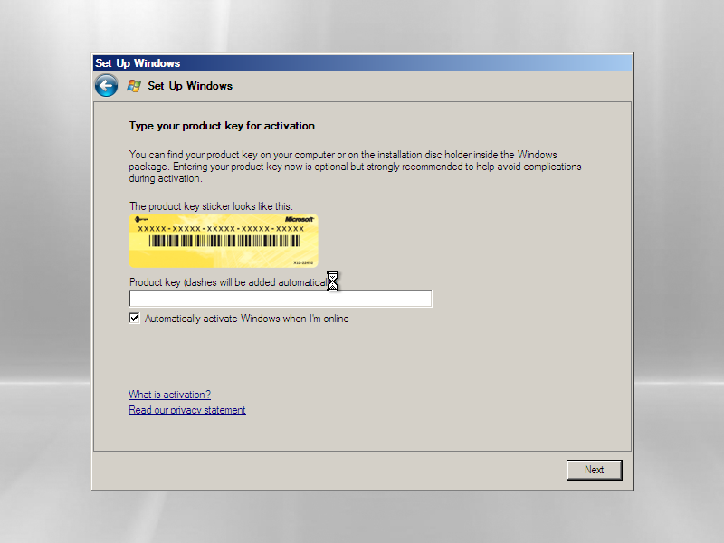

# FRAME M1.5 research and implementation record

**Milestone:** CyberView Reverse Engineering and Virtual Scanner Emulation  
**Status:** Partial implementation in progress - not complete  
**Prepared for:** The FilmScanner project owner  
**Report date:** October 27, 2026, America/New_York  
**Evidence snapshot:** `ef59b52ec57634ce1cc639d170df15a3cde71edd`  
**Project:** [MattLD13/FilmScanner](https://github.com/MattLD13/FilmScanner)

This report brings the M1.5 specification, execution record, binary findings, protocol analysis, guest experiment, tools, tests, reproduction procedures, full extracted-file hash inventory and remaining work into one Markdown document. Research records use October 27-28 UTC; the recorded work occurred on October 27 in the user's Eastern time zone. This is a snapshot, not a claim that unfinished experiments ran later.

**The main result:** the official CyberView installer was obtained and safely extracted, 290 files were inventoried, AFL-specific host software paths were identified, and passive USB research tools were tested. An official Microsoft evaluation guest booted to setup. CyberView itself was never installed or launched, no virtual PF1800 AFL was recognized, and no physical scanner behavior was verified. A Windows 11 compatibility-mode launch is also untested.

This report includes all 290 extracted paths, sizes and SHA-256 values, plus PE dependency summaries. Vendor binaries, Microsoft installation media, guest disks and large raw Ghidra decompilation exports are deliberately not embedded or redistributed. Their locations, identities and reproduction procedures are recorded. The linked machine-readable inventory preserves complete version resources and imported symbol lists.

## Contents

1. [Current result and acceptance](#1-current-result-and-acceptance)
2. [Authoritative milestone requirements](#2-authoritative-milestone-requirements)
3. [Agent assignments and execution history](#3-agent-assignments-and-execution-history)
4. [Official software and binary inventory](#4-official-software-and-binary-inventory)
5. [Reproduce safe extraction](#5-reproduce-safe-extraction)
6. [Binary reverse engineering findings](#6-binary-reverse-engineering-findings)
7. [USB protocol and emulator implementation](#7-usb-protocol-and-emulator-implementation)
8. [Firmware investigation](#8-firmware-investigation)
9. [Official guest media and actual experiment](#9-official-guest-media-and-actual-experiment)
10. [Windows 11 compatibility mode](#10-windows-11-compatibility-mode)
11. [Tests and validation](#11-tests-and-validation)
12. [Blockers and ordered next steps](#12-blockers-and-ordered-next-steps)
13. [Physical hardware testing plan](#13-physical-hardware-testing-plan)
14. [Static analysis reproduction](#14-static-analysis-reproduction)
15. [Research files and evidence identities](#15-research-files-and-evidence-identities)
16. [Actual communication and guest records](#16-actual-communication-and-guest-records)
17. [Complete extracted file inventory](#17-complete-extracted-file-inventory)
18. [PE dependencies](#18-pe-dependencies)
19. [References and terminology](#19-references-and-terminology)

## 1 Current result and acceptance

| Requirement or deliverable | Actual result | Status |
| --- | --- | --- |
| Finish M0 and M1 before M1.5 | Revalidated the existing 41-test gate, production build, TypeScript checks and full 36-frame browser workflow before research began. | Passed |
| Original CyberView software | Official manufacturer-linked package preserved and SHA-256 recorded. | Complete |
| Extract and inventory | Source-built parsers extracted 290 files totaling 24,474,629 bytes. Relative paths, hashes, PE versions and imports are recorded. | Complete |
| Reverse engineering report | Ghidra and static PE/disassembly evidence identify AFL class binding, shared host APIs and distinct U transport code. | Initial pass complete |
| Meaningful hardware communication map | Application and host IOCTL boundaries recovered. Actual AFL USB wire protocol remains missing. | Partial |
| Virtual PF1800 AFL | Passive parsers, exact offline replay and a loopback USB/IP management harness exist. No complete AFL descriptors or successful-response profile is supplied. | Partial |
| Isolated environment | Official evaluation media acquired; QEMU read-only base and disposable overlay booted to first-run setup. | Partial |
| Original CyberView recognition attempt | No CyberView installation, launch, device detection, prescan or acquisition occurred. | Not attempted |
| Communication logs | Real QMP infrastructure traffic and loopback harness exchanges recorded. No original CyberView USB trace exists. | Partial |
| Firmware report | Generic update paths and candidates investigated; no validated AFL firmware image identified. | Initial pass complete |
| Hardware plan | Evidence capture order, stop conditions and virtual-versus-physical checklist documented. | Complete |
| Tests | 22 research tests passed. Latest recorded full local suite passed 71 tests; application browser workflow and Windows CI passed. | Passed within stated scope |

M1.5 remains incomplete because original CyberView detection and an attached evidence-based virtual scanner have not been tested. Sample-image scanning through CyberView is a stretch goal, but an actual detection attempt is part of the milestone's required acceptance. A no-device baseline has not yet been established.

The production `SimulatedScannerBackend` was preserved. No experimental USB command was enabled in FRAME's production backend. No host scanner driver, firmware flash or physical motor experiment was performed.

Evidence terms used throughout:

- **Static fact:** bytes, strings, imports, addresses or instructions present in an identified binary.
- **Documented expectation:** behavior described by a primary source, not observed on the actual scanner.
- **Inference:** an interpretation supported by evidence but not demonstrated at runtime.
- **Harness result:** behavior produced by our own controlled test code.
- **Guest observation:** an actual screen or management result from the isolated Windows guest.
- **Verified on device:** behavior demonstrated on this physical scanner. There are no such findings in this report.

## 2 Authoritative milestone requirements

The following is the M1.5 section added to FRAME_SPEC.md. Its initial PENDING registration is historical; current execution status is partial and in progress. All original milestones were retained. The specification remains authoritative if later project changes supersede this snapshot.

**Initial registration status: PENDING.** Current execution status and evidence belong in `docs/progress.md`.

### Execution rules

1. Finish M0 and M1, including their existing acceptance tests, before starting M1.5. Do not interrupt, restart, reprioritize, cancel, or redirect currently running M0/M1 work or agents.
2. Once M1 passes its acceptance tests, automatically begin M1.5 without another user prompt or additional confirmation merely to start the approved research.
3. Isolate reverse engineering from the production application under separate research directories, using a Git worktree where useful. Preserve the existing scanner simulator; experimental USB emulation must not replace it.
4. Use one primary reverse engineering agent and at most one optional research agent. Preferred assignments are `gpt-6.1-sol` / `xhigh` and `gpt-6-luna` / `medium`, respectively, subject to the supported models and fallbacks in section11.
5. Continue M2 independently when resources permit. Reverse engineering must not block image processing or other software features. Preserve every existing milestone and requirement; after M1.5, continue the existing roadmap.

### 1. Obtain original software

* Locate and download the official Pacific Image PF1800 AFL Windows v1.3 installer from the manufacturer's archive. Record the actual source, redirects, retrieval date, and any identity/version discrepancy rather than relabeling a different package.
* Preserve the original installer and calculate its SHA256 hash.
* Extract without executing untrusted legacy components. Inventory executables, DLLs, TWAIN components, driver files, configuration files, firmware candidates, versions, dependencies, and hashes.

### 2. Reverse engineer CyberView

* Use Reverse Engineer Anything (REA), Ghidra, and other appropriate analysis tools.
* Identify USB vendor/product IDs if present and investigate initialization and device detection.
* Trace film transport/positioning, autofocus, calibration, image acquisition/transfer, and any evidenced exposure, gain, or sensor controls.
* Examine firmware update routines and determine whether firmware data is included.
* Record functions, addresses, supporting artifacts and analysis-tool versions. Separate verified static findings, observed guest interactions, hypotheses, and unknowns; static evidence alone does not verify physical behavior.

### 3. Build a virtual USB scanner

* Investigate QEMU USB device emulation and Python USB/IP; select an appropriate isolated environment.
* Implement a simulated PF1800 AFL device only to the extent supported by recovered evidence: known descriptors/endpoints, a command parser and simulated state machine.
* Connect virtual operations to the existing FRAME simulator where practical through an optional research adapter, without modifying its production behavior.
* Do not invent unsupported command formats to make an emulator appear functional. Reject or log unknown operations explicitly.

### 4. Test original CyberView against the emulator

* Set up an isolated legacy Windows guest with reproducible instructions and a legitimately available licensed installation image.
* Install original CyberView only inside the isolated environment; attempt virtual scanner recognition and capture all communication.
* Reconstruct evidenced initialization responses; investigate calibration, film movement, prescan, and acquisition.
* Return a sample image through original CyberView if sufficient protocol information exists. Prioritize observable, repeatable results; full CyberView scanning through the emulator is a stretch goal.

### 5. Prepare real hardware integration

* Document the reconstructed USB protocol and provide reusable parsers/debugging tools.
* Identify unknown commands requiring actual hardware and prepare bounded, safe experiments for scanner arrival.
* Produce a virtual-versus-physical comparison checklist.
* Keep every experimental USB command disabled in the production scanner backend until validated on the actual device under the existing safety rules.

### Required deliverables

1. CyberView binary inventory with versions, hashes, and dependencies.
2. Reverse engineering report with discovered functions, addresses, and evidence.
3. USB protocol notebook distinguishing verified behavior from inferred behavior.
4. Virtual PF1800 AFL emulator to the extent supported by available evidence.
5. Isolated CyberView testing environment with reproducible setup instructions.
6. Communication logs showing actual emulator interactions, clearly identifying harness-only versus original CyberView traffic.
7. Firmware investigation report identifying available files and remaining unknowns.
8. Real hardware testing plan ready for scanner arrival.

### Safety requirements

* Do not install untrusted legacy kernel drivers on the main Windows installation.
* Do not modify the physical scanner, flash firmware, or perform speculative motor operations.
* Keep experimental work isolated. Successful emulation is never proof of physical hardware compatibility.
* Do not infer permission for system-wide security changes, host driver installation, paid services, or firmware writing from approval to begin this research.

**Done:** Original CyberView is extracted and analyzed; a meaningful communication map exists; an isolated virtual USB environment is implemented and tested; CyberView detection is attempted with results recorded; successfully emulated operations have repeatable tests; all unknowns and physical hardware dependencies are explicit; and the existing FRAME application/simulator tests still pass. If detection or acquisition requires missing real hardware traces, preserve the partial implementation and document the exact blocker. Missing prerequisites are reported as incomplete work, never as an executed guest experiment or a completed milestone.

## 3 Agent assignments and execution history

| Assignment | Model and effort actually requested | Owned work |
| --- | --- | --- |
| Primary reverse engineer | `gpt-6.1-sol`, `xhigh` | Ghidra and static binary investigation, model binding, USB parsers/replay/harness, isolated guest attempt, protocol and firmware reports, physical testing plan. |
| Optional research agent | `gpt-6-luna`, `medium` | Official software discovery, download provenance, safe extraction, complete inventory, tool and official Windows media research. |
| Root integration | Existing root session; no retroactive model change claimed | Milestone registration and gate, integration, independent evidence checks, application regression checks, GitHub checkpoints, independent M2 precision work and this report. |

Only one primary reverse engineer and one optional researcher were assigned to M1.5. No extra M1.5 agent swarm was created. The earlier M0/M1 agents were already complete and were not cancelled or redirected. Both research assignments encountered an account usage-limit interruption, then resumed in the same assignments after the user said to continue. Per-agent token and monetary totals were not exposed, so no cost figures are invented.

| Checkpoint | Change or event |
| --- | --- |
| `877fb23` | Registered M1.5 as PENDING in FRAME_SPEC.md and docs/progress.md. |
| M0/M1 gate | 41 tests passed in 21.33 seconds; checks/build and complete simulated browser workflow passed. Research began only after that gate. |
| Acquisition pass | Official CyberView installer obtained and hashed; the first 7-Zip attempt could not parse the wrapper. |
| Extraction pass | Source-built ISx and Unshield extracted the wrapper and 290 payload files without executing vendor code. |
| Static analysis | Ghidra traced separate AFL and U classes, BeneScan model loading, host selectors and transport wrappers. |
| `7888c0e` | Independent M2 precision work advanced without replacing the simulator or depending on reverse engineering. |
| Official guest media | A Microsoft Server 2008 x86 evaluation VHD was acquired after no user-provided legacy image was available. No cracked image was used. |
| `84a563b` | Preserved the acquisition inventory, extraction reproduction and media evidence in Git. |
| `67e746f` | Fixed shared SQLite connection concurrency exposed by Windows CI; added a six-thread regression. |
| Guest attempt | A bounded, offline QEMU guest reached product-key setup. Computer Use reported a physical Escape stop; automation stopped and QEMU was shut down. |
| `adf4c96` | Saved AFL-specific findings, guest evidence, protocol tools, tests and the Windows 11 compatibility note. |
| `ef59b52` | Added reproducible Ghidra instructions and precise guest-result corrections. |

An early interpretation of the last guest frame as only regional setup was corrected after inspecting the saved image: the furthest captured screen is product-key setup. No key was entered, no activation was submitted and no network adapter was present.

## 4 Official software and binary inventory

Source record: [research/cyberview/acquisition/inventory.md](../research/cyberview/acquisition/inventory.md).

Snapshot date: 2026-10-27 UTC. This report records source/provenance and parser outcomes; vendor binaries remain under ignored `.artifacts` and are not redistributed by Git.

### Original installer provenance

* Official manufacturer page: [All Models Driver Download](https://www.scanace.com/product/all-models-driver-download-user-guide), discontinued-model row **PrimeFilm 1800AFL**.
* Manufacturer link target: Google Drive file ID `1ZO2fiBFpS6v6B5OnsnYTpDq5Qqr7T-yM`, displayed source name `PrimeFilm 1800AFL_Windows_SF_ENG_1.3.exe`.
* Manufacturer page states EOL and **Windows XP/Vista/7 only (nothing newer)**.
* Downloaded 2026-10-27 23:29:07 UTC through the manufacturer link and Drive executable-warning confirmation flow. Redirect: `drive.google.com/uc?export=download&id=...` → `drive.usercontent.google.com/download?...` (303), then confirmed download (200). Drive response `application/octet-stream`, 9,898,119 bytes, `Last-Modified: Fri, 22 Jul 2022 08:45:55 GMT`.
* Original file path (ignored): `research/cyberview/.artifacts/official-pf1800afl-v1.3/PrimeFilm_1800AFL_Windows_SF_ENG_1.3.exe`.
* Size: 9,898,119 bytes. SHA-256: `EBCBE798FE577B9461DF22DB3BDE6240185E0553E65EB9B93D139D367F9109CF`.
* Outer PE resource: `Setup.exe`, InstallShield / Macrovision, FileVersion `14.0.162`, ProductVersion `14.0`, copyright 2007. Authenticode: unsigned (`NotSigned`).
* Embedded printable string: `CyberView X - SF v1.30 (build 20110526)`.

**Identity/version caveat:** the manufacturer-linked filename suffix `1.3`, embedded CyberView string `v1.30`, outer InstallShield version `14.0.162`, TWAIN component `DCVCom.dll` version `2.62`, and `CyberViewX.ds` version `1.4.0.0` are separate version records. There is no basis to call every embedded driver or component “version 1.3.” The package is officially linked from the PF1800AFL row, but contains drivers/resources for several scanner models.

### Parser source and extraction method

Static pefile 2024.8.26 inspection found the PE overlay at offset `0x5B000`, length 9,525,383 bytes. Its first bytes identify `data1.cab`, `Disk1\\data1.cab`, version text `0.0.0.0`, the decimal length `498554`, then InstallShield `ISc(` magic. The wrapper does not begin with Microsoft CAB `MSCF` or `ISSetupStream`. 7-Zip 22.01 reports “Cannot open the file as archive” on the whole EXE; this is an unsupported wrapper/container, not evidence of absent contents.

The wrapper parser was [ISx](https://github.com/lifenjoiner/ISx), source commit `3c4177ddd0519244490ff8e78d380110c8dacdc8` (MIT). Its source README claims DevStudio 9 (2003) through InstallShield 2021; its source version table maps InstallShield 2008 to version 14.

The source was inspected and built in a temporary directory with the installed Visual Studio 2022 compiler. Source file hashes: `ISx.c` `BD9FCC51BC9C4A1C1462A29D1553E276DAE39C0356D554077B2AB08442B8617F`; `inflate_tinfl.c` `2BD26446D6F033E863585330C86EA78DE4F23A56E3AB5EFFD111A49CE543F0BF`. A temporary source copy added path rejection for absolute paths, drive prefixes, `.` and `..` components; build used `cl.exe /nologo /DNO_INFLATE /O2 /FeISx-reviewed.exe ISx-reviewed.c`. The source parser wrote only into a unique temporary directory. It peeled ten wrapper files into `Disk1/` with exit code 0, then printed `Unrecognized version installer!`; the listed embedded CAB and support files were present. The warning is retained as a parser diagnostic.

The ten-file wrapper output includes `data1.cab` (498,554 bytes), `data1.hdr` (55,483), `data2.cab` (7,427,648), `ISSetup.dll`, `setup.exe`, `setup.inx`, `setup.isn`, and support files. Extracted `data1.cab` SHA-256: `4B7897BCF5BB45DE933F16C7BEEFE9A5FE97914BC422EEC5D1AD9218A4A6300D`; `data1.hdr` SHA-256: `8735A68BD3ED4572EBDD2125EB1B2677222385752986640D1F85C277B447E100`.

For the inner CAB, [Unshield](https://github.com/twogood/unshield) source commit `feaa32f6227fb306a87f4249a6618aa2ddd49966` was used. Its README describes support for InstallShield cabinets version 5 and later; license is MIT. The source build used Visual Studio 2022/MSVC and CMake against [zlib](https://github.com/madler/zlib) source commit `71747d1d39168833e0cae8ed84b8ce77cb049699` (zlib license), static build, and no OpenSSL. The project was built in a temporary folder; no vendor code was executed.

Commands/results:

```text
ISx-reviewed.exe <official-installer.exe> <unique-temp-output>
  exit 0; extracted wrapper support files; diagnostic: "Unrecognized version installer!"
unshield.exe -V
  Unshield version 1.6.2. MIT License.
unshield.exe l <Disk1/data1.cab>
  exit 0; 290 listed paths; no absolute/drive-prefixed/.. paths found
unshield.exe -d <ignored-artifact-payload-dir> x <Disk1/data1.cab>
  exit 0; 290 files, 24,474,629 bytes
```

Extracted data is preserved under ignored `research/cyberview/.artifacts/extracted-pf1800afl-v1.3/`. The complete tracked per-file inventory, with paths relative to `payload/`, byte counts, SHA-256, PE version resources, architectures, imported DLLs and imported symbols where parseable, is [payload-inventory.json](../research/cyberview/acquisition/payload-inventory.json). A generated copy remains beside `Disk1/` and `payload/` in ignored artifacts. No payload file was run or installed.

### Extracted version and driver evidence

| Component | Size | Version evidence | SHA-256 |
|---|---:|---|---|
| `CyberViewX_SF/DCVCom.dll` | 925,696 | TWAIN 32 data source; `FileVersion=2.62`; PE x86 | `17EB0E7539F9B63326C5DC3726E7E714D7D854399F189E1B3018F6F2DDBBFE79` |
| `Resource_ENG/CyberViewX.ds` | 2,019,328 | CyberViewX; `FileVersion=1,4,0,0`; PE x86 | `50C9B359417CA61E555A743B8E7351DF43A22585822AA79C334140DD0EB6D64E` |
| `CyberViewX_SF/PfsLoader.exe` | 245,760 | PfsLoader; `FileVersion=1,0,1,2`; PE x86 | `14AE1CD755718626AC69FC912EA2B703343F2076A43F93F377103FA0706A0299` |
| `CyberViewX_SF/PF1800U.dll` | 143,360 | `FileVersion=1,0,2,6`; PE x86 | `6A694BF6344C90E11F961B29239F99BE82567D0DC3FCF790F213602D44414F03` |
| `GENEUSB_W2K_SYS/GENEUSB.SYS` | 10,624 | PE x86; no version resource | `38480891911EBBD55F8AD08C084DF893D2C43714D5B7E5C40943A44124D296AD` |
| `USBSCAN_W2K/USBSCAN.SYS` | 12,400 | Microsoft USB Scanner Driver `5.00.2151.1`; PE x86 | `801FE8DD420BE927C3ED795C6B8B432B880D9A52A58EA7A190A6D364E6B492B5` |
| `USBSCAN_W9X/usbscan.sys` | 8,944 | Microsoft `Logitech USB Scanner driver` `4.10.1998`; PE x86 | `1593856C798D3714BDBB7F6E05107896ED008778D47C56F9BE63A9B179FE23F3` |
| `INF_WNT/PF1800U.INF` (same hash in W9X/Vista) | 2,678 | Text names PF1800U, generic “Single Frame Film Scanner,” VID `05E3`, PID `0120` | `091B7B7308F53B26813624655A100B8091D0B3E4C849C7900EC1A8BDA2DFDA7B` |

The INF says it is for Windows Vista x86/x64 but references `usbscan.sys`; its contents name **PF1800U**, not PF1800AFL, and genericize the device description. The package came from the official PF1800AFL download row, but the exact relationship between the INF family, hardware ID and physical AFL model still requires model-specific evidence. This package contains several scanner families (including PF2700, PF3600U, PF7250U); do not attribute every component to the AFL without checking setup metadata and source code.

#### AFL-specific dependency check

The complete Unshield listing contains 290 entries and no standalone payload path named `SCAN08.dll`. The package does contain a `PF1800U.dll` (version `1.0.2.6`), but its distinct name/model evidence is not grounds to treat it as a substitute. A raw bytescan found `SCAN08`/`SCAN08.dll` strings embedded in `CyberViewX_SF/BeneRaw.dll`, `BeneScan.dll`, `LC.dll`, `Resource_ENG/CyberViewX.ds`, `WXP_DLL/PF1800LC.Dll`, `WXP_DLL/PWiaScnr.dll`, and DPInst copies. The reverse-engineering agent reports that the CyberViewX model table's `CPfs1800AFL` constructor requests `SCAN08.dll`; whether an embedded component supplies it still requires code analysis. This is static package evidence, not a physical device test.

The [manufacturer all-model download page](https://www.scanace.com/product/all-models-driver-download-user-guide) exposes a Windows download for **PrimeFilm 1800AFL** and a separate row for **PrimeFilm 1800u/i & 1800 Silver**. The [manufacturer troubleshooting page](https://www.scanace.com/product/troubleshooting) directs owners of old PrimeFilm 1800-series software to the all-model page and says legacy driver development ended around Windows 7. Searches on the official ScanAce domain for `SCAN08`, `PrimeFilm 1800AFL SCAN08`, and `PF1800AFL_Windows` did not locate another AFL package or CD image. There is no standalone `SCAN08.dll` path in this official archive. The embedded string references may resolve to code in one of the listed binaries, so a separate missing runtime dependency is not established. The user's original CD or a direct vendor response remain possible sources if further analysis confirms a separate file is required. No unrelated-model DLL or third-party DLL download was substituted.

## 5 Reproduce safe extraction

Source record: [research/cyberview/acquisition/extraction-replay.md](../research/cyberview/acquisition/extraction-replay.md).

This recipe uses pinned MIT/zlib-licensed source parsers and never executes the vendor installer or extracted payloads. Keep output in a fresh directory under `research/cyberview/.artifacts/`, which is Git-ignored. Preserve the source repositories' `LICENSE` files and notices when using or redistributing their source/builds. No vendor binary belongs in Git.

### 1. Fetch source at the reviewed commits

From PowerShell in the repository root. Resolve the workspace root first so patch and artifact paths do not accidentally resolve inside the temporary parser checkout:

```powershell
$repo = (Resolve-Path '.').Path
$artifactRoot = Join-Path $repo 'research/cyberview/.artifacts'
$work = Join-Path $env:TEMP 'frame-isx-source'
git clone https://github.com/lifenjoiner/ISx.git $work
git -C $work checkout --detach 3c4177ddd0519244490ff8e78d380110c8dacdc8
$patch = Join-Path $repo 'research/cyberview/acquisition/isx-safe-path-guard.patch'
git -C $work apply --check $patch
if ($LASTEXITCODE -ne 0) { throw 'ISx safety patch does not apply cleanly' }
git -C $work apply $patch
if ($LASTEXITCODE -ne 0) { throw 'ISx safety patch failed to apply' }
```

ISx upstream source commit `3c4177ddd0519244490ff8e78d380110c8dacdc8` has an MIT license. The guard patch rejects absolute paths, drive prefixes, and `.`/`..` components before ISx concatenates the archive entry name to its destination. It changes only the temporary source checkout. The source file hashes before patching were recorded in [inventory.md](../research/cyberview/acquisition/inventory.md).

### 2. Build and run ISx against the wrapper

Use the installed Visual Studio 2022 Build Tools compiler; this command assumes the standard Build Tools path:

```powershell
$vsdev = 'C:\Program Files (x86)\Microsoft Visual Studio\2022\BuildTools\Common7\Tools\VsDevCmd.bat'
cmd.exe /d /c "`"$vsdev`" -arch=x64 && cd /d `"$work`" && cl.exe /nologo /DNO_INFLATE /O2 /FeISx-reviewed.exe ISx.c"
```

`/DNO_INFLATE` omits ISx's optional inflate helper; the wrapper CAB streams and required support files were recovered without it. Run ISx only on the acquired installer and direct its writes to a new, empty `.artifacts` destination:

```powershell
$dest = Join-Path $artifactRoot 'extracted-pf1800afl-v1.3'
if (Test-Path -LiteralPath $dest) { throw 'Use a fresh artifact output path' }
New-Item -ItemType Directory -Path $dest
& (Join-Path $work 'ISx-reviewed.exe') `
  (Join-Path $artifactRoot 'official-pf1800afl-v1.3/PrimeFilm_1800AFL_Windows_SF_ENG_1.3.exe') `
  $dest
```

Expected wrapper output includes `Disk1/data1.cab`, `data1.hdr`, `data2.cab`, and InstallShield support binaries. ISx may emit `Unrecognized version installer!` after extracting these files; treat it as a diagnostic and confirm the expected streams exist and have the recorded hashes before continuing. Never launch the emitted `setup.exe` or `_sfx.exe`.

### 3. Build Unshield from pinned source and extract the inner CAB

Unshield source commit `feaa32f6227fb306a87f4249a6618aa2ddd49966` is MIT-licensed. It reads the InstallShield CAB/header that ISx peeled from the wrapper; it does not parse the setup EXE itself. Its CMake build uses zlib. The extraction was made with zlib source commit `71747d1d39168833e0cae8ed84b8ce77cb049699` and the zlib license.

```powershell
$cmake = 'C:\Program Files (x86)\Microsoft Visual Studio\2022\BuildTools\Common7\IDE\CommonExtensions\Microsoft\CMake\CMake\bin\cmake.exe'
$zsrc = Join-Path $env:TEMP 'frame-zlib-source'
$zbld = Join-Path $env:TEMP 'frame-zlib-build'
$usrc = Join-Path $env:TEMP 'frame-unshield-source'
$ubld = Join-Path $env:TEMP 'frame-unshield-build'
git clone https://github.com/madler/zlib.git $zsrc
git -C $zsrc checkout --detach 71747d1d39168833e0cae8ed84b8ce77cb049699
git clone https://github.com/twogood/unshield.git $usrc
git -C $usrc checkout --detach feaa32f6227fb306a87f4249a6618aa2ddd49966
& $cmake -S $zsrc -B $zbld -A x64 -DZLIB_BUILD_TESTING=OFF
& $cmake --build $zbld --config Release --target zlibstatic --parallel 4
$zlib = Join-Path $zbld 'Release/libzs.lib'
& $cmake -S $usrc -B $ubld -A x64 -DBUILD_STATIC=ON -DUSE_OUR_OWN_MD5=ON `
  "-DZLIB_INCLUDE_DIR=$zsrc" "-DZLIB_LIBRARY=$zlib" -DBUILD_TESTING=OFF
& $cmake --build $ubld --config Release --target unshield --parallel 4
```

Before extraction, list the cabinet and inspect every returned path for absolute paths, drive prefixes, or `..` components. For this package, the list had 290 safe relative paths. Then extract into a new empty payload directory under the artifact root:

```powershell
$payload = Join-Path $dest 'payload'
New-Item -ItemType Directory -Path $payload
$unshield = Join-Path $ubld 'src/Release/unshield.exe'
& $unshield l (Join-Path $dest 'Disk1/data1.cab')
& $unshield -d $payload x (Join-Path $dest 'Disk1/data1.cab')
```

Expected result for this installer: Unshield 1.6.2; 290 files, 24,474,629 bytes, exit code 0. Generate SHA-256 and static PE version/import inventories for the resulting tree. Do not execute, register, install, or load any extracted executable, DLL, SYS, INF, or script.

### Current source and output records

* Pinned parser commits, package source and extracted output hashes are in [inventory.md](../research/cyberview/acquisition/inventory.md).
* The complete relative-path inventory is [payload-inventory.json](../research/cyberview/acquisition/payload-inventory.json).
* Original installer, extracted CABs, and extracted payload remain in ignored `.artifacts/`.

## 6 Binary reverse engineering findings

Source record: [research/cyberview/reverse-engineering.md](../research/cyberview/reverse-engineering.md).

Research pass: 2026-10-27–28 UTC. **M1.5 is incomplete.** The official installer
was preserved and statically extracted; a useful model/host-I/O map and tested
passive laboratory exist. Original CyberView has not yet been installed or
launched inside the evaluation guest. No PF1800AFL USB device has been enumerated
by a guest, and no physical scanner behavior is verified.

### Artifact identity and evidence rules

The manufacturer-linked installer is 9,898,119 bytes, SHA256
`EBCBE798FE577B9461DF22DB3BDE6240185E0553E65EB9B93D139D367F9109CF`.
The source, redirects, source-built extraction tools, licenses, all 290 extracted
files and their hashes/versions/imports are recorded in
[the acquisition inventory](../research/cyberview/acquisition/inventory.md) and
[machine-readable inventory](../research/cyberview/acquisition/payload-inventory.json).
No legacy installer, DLL or driver was executed on the host.

The filename's `1.3`, embedded `CyberView X - SF v1.30 (build 20110526)`,
InstallShield `14.0.162`, and TWAIN `CyberViewX.ds` resource version `1.4.0.0`
are distinct version records. This package contains several scanner families.
An official PF1800AFL download link does not make every included driver an AFL
driver.

All addresses below are **preferred image virtual addresses** in the exact named
32-bit PE, not file offsets or runtime relocated addresses. A static instruction,
string, import or RTTI relationship is labeled STATIC. A semantic interpretation
without an actual operation trace is INFERRED. None is VERIFIED ON DEVICE.
Ghidra warnings about unsettled type propagation mean inferred parameter types
and return types must be checked against disassembly. Windows `GetFocus` and
`SetFocus` imports refer to UI keyboard focus; they are not optical focus evidence.

### Analysis tools actually used

* Ghidra **12.1.4**, official NSA release
  `ghidra_12.1.4_PUBLIC_20260921.zip`, using 64-bit JDK **21.0.10** from the existing
  Android Studio JBR. No global Java change was made. The PATH Java8 was unsuitable.
* Python **3.13**, isolated `pefile==2024.8.26`, `capstone==5.0.9`. Dependencies and
  downloaded tools remain ignored under `research/.tools/`.
* [REA installation requirements](https://github.com/morluto/rea/blob/main/docs/installation.md)
  were investigated. REA was not installed or run: the available Node24.19.0 is
  below the retrieved REA6.8.0 Node24.22.1 requirement. Direct Ghidra headless and
  Capstone supplied the static analysis. No REA analysis is claimed.
* Headless results: PF1800U.dll **721 functions /64 selected**, daspi32u.dll
  **437/56**, CyberViewX.ds **6531/270**, BeneScan.dll **1489/25**. Explicit AFL
  virtual-method and loader follow-ups were also decompiled with disassembly.
  Raw exports and analyzer logs remain in ignored `.artifacts`; reproducible
  survey scripts are in [analysis/](../research/cyberview/analysis).

Initial headless project creation failed because Ghidra forbids a path component
starting with `.`. Projects were then created in ignored
`analysis/workspace.ghidra/`; analysis succeeded. This path requirement does not
affect importing binaries from `.artifacts`.

### AFL-specific class and driver binding

`Resource_ENG/CyberViewX.ds` SHA256
`50C9B359417CA61E555A743B8E7351DF43A22585822AA79C334140DD0EB6D64E`
contains distinct `CPfs1800AFL`, `CPfs1800Lab`, `CPfs1800P`, and `CPfs1800U` RTTI.
The reproducible [RTTI candidate map](../research/cyberview/analysis/rtti-evidence.json) records their
type descriptors, virtual tables and method slots.

| Binary/address | STATIC finding | Implication / confidence |
| --- | --- | --- |
| CyberViewX.ds `0x101510e4` /`0x10129264` | `CPfs1800AFL` type descriptor and 111-entry virtual table | High confidence class identity; slots alone do not name operations. |
| CyberViewX.ds `0x100a8520` | Constructor assigns that AFL table and driver-name string `SCAN08`; it also sets a field to `0x28` | High confidence binding string. `0x28` is not promoted as a validated maximum roll length. |
| CyberViewX.ds `0x100a9fe0` /`0x101297dc` | Separate U constructor uses `PF1800U` and a distinct table | The PF1800U USB identity cannot simply be assigned to AFL. |
| CyberViewX.ds `0x100a8490` →`0x100bb2a0` | AFL table slot61 enters common binding. It loads `BeneScan.dll`, resolves `ScannerDeviceIO`, calls host API selectors1,5,0x16,0x14 | Host library boundary identified; selectors are not USB opcodes. |
| BeneScan.dll `0x10011840` /`0x10010a30` | Export `ScannerDeviceIO` creates a scanner object and dispatches API selectors through a handler table | Recovered host API dispatcher. |
| BeneScan.dll `0x1000c0f0` /`0x1000bf50` | Discovery/open walk 0x44-byte model-table records at `0x100450d0` | Selection uses model records and dynamically loaded modules. |
| BeneScan.dll `0x1004519c` /`0x100451a0` | Model `0x25` record contains `SCAN08.dll` | Concrete model module name in the driver loader's table. |
| BeneScan.dll `0x100106d0` /`0x10010040` | Builds module-directory + table filename, calls `LoadLibraryA`; fallback loads the filename; then resolves `ScannerDeviceIO` | Strong evidence of an external DLL load path in this examined code. |

`BeneRaw.dll` and `BeneScan.dll` are byte-identical, SHA256
`ACD215AA92EC45B79837A6DC0ECF4A008AAE772A6A6946C98A93B9570635C27C`.
The 290-file listing contains **no standalone `SCAN08.dll`**. Strings naming it
also occur in LC/WIA components. A string is not an embedded executable, and the
examined BeneScan path loads an external file; however, a successful runtime trace
or exhaustive installer/resource recovery has not established whether another
installation path generates/supplies it. Therefore this is a **specific likely
dependency gap**, not a proven guest loader failure. Do not rename PF1800U.dll or
substitute a DLL from another scanner model. The original CD remains an important
comparison source.

### Detection, transport and acquisition map

`PF1800U.dll` SHA256
`6A694BF6344C90E11F961B29239F99BE82567D0DC3FCF790F213602D44414F03`
is included and statically analyzable, but is the distinct U path.

| Binary/address | STATIC evidence | Scope / remaining unknown |
| --- | --- | --- |
| PF1800U `0x10001cb0` | Opens `\\.\Geneusb%d` then `\\.\usbscan%d`, indexes0–126; checks VID`05e3`, PID`0120` | Matches PF1800U.INF. Actual AFL identity remains unknown. |
| PF1800U `0x10007b90` | Exported `ScannerDeviceIO` dispatches host selectors; selector1→`0x100050a0`,3→`0x10005460`,0x13→`0x100057f0`,0x20→`0x10006e00` | Named host boundary; no USB opcode equivalence. |
| PF1800U `0x10003480` | Builds 16-byte block; `DeviceIoControl(...,0x80002010,...)` | x86 USBSCAN-compatible `IO_BLOCK` write path. |
| PF1800U `0x100021d0` | Writes register offset0x83, then reads offset0x84 using IOCTL`0x8000200c` | Register address and length are static; register meanings need traces. |
| PF1800U `0x100034f0` | Writes offset0x82 with an 8-byte block before `ReadFile`; splits at0xf000 bytes | Buffered transfer/chunk strategy. `0x82` here is a register value, **not a proven endpoint address**. |
| PF1800U `0x10002260` | Another read path writes offsets0x83/0x82, then `ReadFile`, chunks≤0xffff | Host path exists; successful frame lengths/channel order not measured. |
| PF1800U `0x100050a0` /`0x10007230` | Allocates acquisition buffers, prepares `PF1800U.log`; calibration/start-scan log labels include RGB gain, DC and exposure | Sensor-control evidence in the U implementation; units/ranges and AFL applicability unverified. |
| CyberViewX.ds `0x100a8660` | AFL-specific table slot50 manages Number Scanned and invokes host selector9 or shared helper`0x100b9d50` | Roll/advance orchestration inferred. Wire format/position units/safe motion bounds remain unknown. |
| CyberViewX.ds `0x100b8fd0` /`0x100b9000` | Shared AFL table methods invoke selector10 with a two-word block whose first word is1 or2 | Direction-like host API variants; forward/reverse semantics need original UI traces. |
| CyberViewX.ds `0x100bb1a0` /`0x100bb240` | Status/IsDocumentInFeeder strings, selector0x15, masks on returned status | Shared status bit handling; no actual sensor observations. |
| CyberViewX.ds `0x100a8860` | AFL acquisition override builds settings/LUT buffers and thread/event callbacks; calls selector0x20; helper`0x100b9ac0` delivers rows/chunks | Genuine application acquisition architecture, not proof of CCD live streaming or effective precision. |
| daspi32u `0x100017c8` /`0x100016a3` /`0x10001738` | Generic Geneusb/Usbscan enumeration and identity queries | Family transport reference; another routine`0x10001e4b` requests05e3:0129, so cannot be assigned wholesale to AFL. |
| daspi32u `0x1000140b` /`0x10001464` | Read/write IO_BLOCK wrappers | Independent confirmation of host control structure. |
| daspi32u `0x10001c15` | Export `_UsbMotorControl@16` builds six bytes and writes register0x89 | Real static motor-related symbol; purpose, bounds and target model unverified. Never issued. |
| daspi32u `0x1000139f` | `_UsbWriteScannerFw@8` builds a transfer prefix and calls bulk-write helper | Generic firmware-named path, not an AFL updater proof. |

Optical autofocus is documented by the specification/manual context and generic
CyberView UI/classes (`CAutoFocusDlg`, `CAutoFocusPS`). This pass did **not** recover
an AFL-specific focus wire command or safe focus bounds. Calibration, exposure and
gain are likewise investigated above without claiming a reconstructed AFL
protocol. Firmware details are in [firmware-report.md](../research/cyberview/firmware-report.md).

### Executed isolated laboratory results

[USB protocol notebook](../research/cyberview/protocol-notebook.md) identifies exactly what the parsers
understand. They reject unsupported or ambiguous commands, malformed descriptors,
oversized transfers and out-of-order replay. There is no default PF1800 descriptor
or fabricated response profile. The optional FRAME simulator adapter was omitted:
there is no evidenced wire operation to map to it, and inventing a mapping would
make a misleading emulator. The production simulator and hardware enablement
remain untouched.

Portable QEMU11.1 was extracted without executing its installer; its published
SHA512 matched. An actual stopped/diskless/no-NIC QMP smoke test passed. A real
Python loopback TCP USB/IP management exchange passed: DEVLIST returned zero
devices, IMPORT failed explicitly, unknown management traffic was rejected.
Those [logs](../research/usb/evidence) are **harness-only**, not CyberView communication.
The exact replay engine also passed deterministic synthetic-fixture tests; it
has no captured PF1800 profile.

The officially downloaded Server2008 x86 evaluation VHD was booted in a writable
qcow2 overlay over an explicitly read-only hash-verified base, with no NIC, shared
host folder or physical USB passthrough. It advanced through regional OOBE to the
product-key page (blank key; default autoactivation checkbox checked; no
activation submitted and no NIC). The first attempt's relative pointer input
initially appeared delayed; a second bounded start added
QEMU's standard USB tablet. Computer Use then reported that the **user stopped it
with the physical Escape key**. UI automation ceased immediately, and our QEMU
was stopped through its own management socket. No CyberView execution or device
detection occurred. This is a stopped guest-preparation attempt, not a vendor
detection test. Details and remaining prerequisites are in
[guest-environment.md](../research/cyberview/guest-environment.md).

Validation during this pass: `python -m pytest -q tests/research` → **22 passed in
0.07s** (19 USB/replay tests plus3 inventory tests). This is not a substitute for
the root's full application/workflow validation. Physical testing remains governed
by [hardware-plan.md](../research/cyberview/hardware-plan.md).

## 7 USB protocol and emulator implementation

Source record: [research/cyberview/protocol-notebook.md](../research/cyberview/protocol-notebook.md).

This notebook contains **static observations and explicit unknowns**, not a
captured PF1800AFL protocol. No vendor USB trace or physical scanner capture has
been acquired. All shipped communication logs are labeled with their true source.

### Evidence layers

| Layer | Available evidence | What it does not establish |
| --- | --- | --- |
| CyberView host API | AFL RTTI/vtable, `BeneScan.dll!ScannerDeviceIO` selectors | USB command bytes or endpoint addresses |
| User/driver boundary | PF1800U and generic daspi32u DeviceIoControl wrappers | Actual AFL model selection or driver response |
| Driver documentation | Microsoft USBSCAN IO_BLOCK and documented request mapping | Behavior of the exact old Geneusb/USBSCAN binary on this unit |
| USB wire | None from vendor software/hardware | Descriptors, actual initialization, status or frame payloads |
| Laboratory transport | Real loopback USB/IP management traffic; QEMU infrastructure smoke | Windows USB enumeration or CyberView detection |

### Identification

`INF_*/PF1800U.INF` and PF1800U.dll `0x10001cb0` agree on `05e3:0120`. The
application has a distinct `CPfs1800AFL` class that selects `SCAN08`, while the U
class selects `PF1800U`. The exact AFL VID/PID is therefore **not established** by
that U evidence. No physical/guest descriptor is synthesized from an INF.

Still unknown: bcdUSB/bcdDevice, device class/protocol, endpoint-zero packet size,
configuration power attributes, interfaces, alternate settings, bulk/interrupt
endpoint addresses and sizes, strings/language IDs, serial behavior, device speed,
and any reset/re-enumeration sequence. In particular, a user-mode register offset
`0x82` is not an endpoint descriptor for endpoint0x82.

### Recovered host control structure

PF1800U.dll `0x10003480`, daspi32u.dll `0x1000140b` and `0x10001464` build the
following **x86 host-memory** structure passed to `DeviceIoControl`:

| Byte offset | Size | Field | Evidence |
| --- | --- | --- | --- |
| 0 | 4 | uOffset | Low-byte mask in wrappers |
| 4 | 4 | uLength | Low-byte mask in wrappers |
| 8 | 4 | pbyData | Process pointer; never dereference in the passive parser |
| 12 | 4 | uIndex | Explicit zero in several callers; generic wrapper may leave stack-derived data |

IOCTL0x8000200c reads registers; IOCTL0x80002010 writes them. This matches
[Microsoft IO_BLOCK documentation](https://learn.microsoft.com/en-us/windows-hardware/drivers/ddi/usbscan/ns-usbscan-_io_block).
The documented USBSCAN translation uses value=uOffset, index=uIndex and
length=uLength; register reads/writes use IN/OUT vendor-device request types and
request0x04 for multiple bytes or0x0c for one byte.
[Read mapping](https://learn.microsoft.com/en-us/windows-hardware/drivers/ddi/usbscan/ni-usbscan-ioctl_read_registers),
[write mapping](https://learn.microsoft.com/en-us/windows-hardware/drivers/ddi/usbscan/ni-usbscan-ioctl_write_registers).

That mapping is a **documented expectation**, never an observed scanner setup
packet. The old driver/Geneusb branch must be compared with a raw trace. A pointer
in the host structure is not transmitted on USB and is omitted from exported
decoder output. No checksums, handshakes, response bytes or operation timings are
invented.

### Static register and data observations

* PF1800U read helper`0x100034f0` writes offset0x82,8-byte block, then ReadFile;
  chunks are≤0xf000. Another helper`0x10002260` uses≤0xffff chunks. These are
  host transfer limits, not a measured USB maximum packet size or image row size.
* PF1800U helpers`0x10002140`/`0x100021d0` access offsets0x83,0x85,0x84. Meanings
  remain unknown; request addresses alone do not establish safe queries.
* daspi32u motor export`0x10001c15` writes offset0x89 with six bytes containing
  two16-bit and two8-bit arguments. Physical units, direction, endpoints, motor
  limits and actual model applicability remain unknown. It is blocked from use.
* Generic `_UsbWriteScannerFw@8` exists. No firmware command is allowlisted.

There is no evidenced complete PF1800AFL command CDB/framing registry. The default
`decode_command` consequently rejects every vendor payload. Host API selectors9,
10,0x15 and0x20 are **not** inserted into that registry as USB opcodes.

### Implemented research tools and actual results

`research/usb/protocol.py` passively decodes exact8-byte USB setup packets and
descriptor sequences; it validates lengths, preserves unknown descriptor bytes,
and rejects malformed/truncated data. `legacy_ioctl.py` decodes copied16-byte
x86 IO_BLOCK data and reports the documented mapping separately from observations.
It never reads process memory or opens a device.

`inspect_trace.py` reads explicit JSONL hex records; malformed/unknown rows are
reported and parsing continues. It will not overwrite a source or existing output.
Example input format: `{"kind":"setup","hex":"8006000100001200"}`. This is a
generic standard-USB example, **not a PF1800 capture**. Run:

```powershell
python -m research.usb.inspect_trace input.jsonl new-analysis.jsonl
python -m pytest -q tests/research
python -m research.usb.usbip --exercise-log new-harness-run.jsonl
```

`usbip.py` implements the actual standard USB/IP **management plane** on
127.0.0.1: fragmented8-byte DEVLIST request→empty list; IMPORT→failure; unsupported
operation→close/log. It accepts≤8 active connections,2-second bounded reads,
≤2048 retained events and no physical USB access. The passive CMD_SUBMIT decoder
validates direction, endpoint, transfer size and control wLength; isochronous
transfers are rejected. It does not claim a kernel-importable PF1800 device.
Protocol reference: [Linux USB/IP](https://docs.kernel.org/usb/usbip_protocol.html).

`replay.py` implements detached→replaying→exhausted state with exact request/order
matching and explicit unknown-transfer rejection. A profile requires provenance
and bounded data; no PF1800 profile is supplied. Its tests use fictitious1234:5678
standard descriptor fixtures. Those fixtures never advertise a scanner to Windows.

Actual [harness-usbip-2026-10-27.jsonl](../research/usb/evidence/harness-usbip-2026-10-27.jsonl)
contains four real loopback-management events. Each has `source=harness-only`,
`cyberview_guest=false`, `physical_device=false`. There is no original CyberView
traffic to compare yet. [QEMU smoke](../research/usb/evidence/qemu-smoke-2026-10-27.json)
records stopped CPU state and infrastructure availability; it is not enumeration.

### Next evidence required

Complete ordinary guest setup with permitted UI control, preserve a clean
CyberView no-device baseline, resolve model-module packaging, then capture actual
descriptors and the first initialization sequence. Only after observed bytes are
available should a replay profile or QEMU/usbredir scanner device be created.
Each later calibration, documented movement, focus, prescan, acquisition and eject
action needs its own original-software trace. Unknown operations must stall/log.
No production hardware operation becomes enabled from these static findings.

## 8 Firmware investigation

Source record: [research/cyberview/firmware-report.md](../research/cyberview/firmware-report.md).

Status: STATIC INVESTIGATION ONLY. No firmware readout, updater execution,
physical inspection, scanner write or flashing has occurred.

The official package's290-file inventory has no standalone `.bin`, `.hex`, `.rom`
or `.fw` firmware image. `PScanner.CFG` is a configuration candidate beginning
`PIE Macross 1.103`, not a validated firmware image. InstallShield `layout.bin` is
installer metadata; its extension is not evidence of device firmware. Unknown
embedded blobs have not been identified by controller architecture or validated
against a known image. Full file hashes are in the acquisition inventory.

| Static location | Finding | Limit |
| --- | --- | --- |
| CyberViewX.ds `0x101cc0e6`, `0x101d1328` | Update Firmware menu/resource strings | Generic multi-model UI; not proof AFL can update. |
| CyberViewX.ds `0x101d1c4e` | Error message expects firmware-upgrade filename `*.bin` | No corresponding image found in this package. |
| CyberViewX.ds `0x101d1d8e` /`0x101d1ef6` | Version-comparison and upgrade-duration messages | Resource text, not observed acceptance or measured duration. |
| daspi32u.dll `0x1000139f` | Export `_UsbWriteScannerFw@8`, prefix bytes1,1,0,0 plus size; calls generic write helper`0x100015c4` | Family implementation; AFL applicability and update framing unknown. Not executed or allowlisted. |
| PF1800U.dll `0x100050a0`, log string`0x1001b17c` | SDK log emits `F/W Version = NO F/W` | Distinct U module's label, not evidence that AFL has no firmware. |
| CyberViewX.ds `0x100a8520` →BeneScan model table | AFL path names `SCAN08`/`SCAN08.dll` | No standalone module in extracted file inventory; cannot fully inspect AFL controller implementation yet. |

Neither controller family nor nonvolatile storage type is established. The VID
manufacturer name, a related-model DLL or generic motor/firmware export is
insufficient. No claim of a Cypress/Genesys CPU, EEPROM layout, bootloader,
recoverability, update checksum, signed image, version response or writable flash
is made. Generic UI focus imports are unrelated to sensor firmware.

Next useful work is read-only: compare the user's original CD with these hashes;
resolve the AFL-specific driver module; capture normal enumeration/initialization
using vendor software; inspect any genuine model-specific firmware version query
in those traces. Board inspection is deferred until after the return period and
requires a separate power/lamp-inverter safety plan. A verified readout and recovery
strategy would precede any discussion of writing. **No custom firmware flashing
is part of M1.5 or the initial deliverables.**

## 9 Official guest media and actual experiment

Source record: [research/cyberview/guest-environment.md](../research/cyberview/guest-environment.md).

Status: **guest boot attempted; CyberView detection not attempted.** The official
Microsoft Server2008 Enterprise x86 evaluation VHD advanced through regional OOBE
to the product-key setup page in QEMU.
CyberView was not installed/launched, and no PF1800 USB device was presented.
The user subsequently stopped Computer Use with the physical Escape key; UI
automation ceased and the research QEMU process was stopped. No authentication,
password, activation or security setting was bypassed.



This is a lossless PNG conversion of an actual QMP guest screendump, not a
mockup. The raw PPM remains in ignored `.artifacts/guest-lab/`. The visible screen
is Windows setup, not original CyberView.

### Media and terms examined

The bounded inventory initially found VirtualBox installed with no registered
machines. No user-provided licensed XP/Vista/7 image was available. Research then
located the [official Microsoft Server2008 x86 evaluation VHD](https://www.microsoft.com/en-us/download/details.aspx?id=14527).
The three official archive parts, retrieval URLs, hashes, README/EULA hashes and
extraction process are in [acquisition/inventory.md](../research/cyberview/acquisition/inventory.md).

The supplied XPS EULA was read before boot: internal demonstration/evaluation,
60 days from first installation, no activation, no redistribution/live production;
it permits a virtualizer capable of VHD. The README describes Hyper-V setup and
explicitly instructs leaving the product key blank and disabling automatic
activation. No activation, rearm, date rollback or expired-evaluation bypass was
attempted. The exact guest's expiry state was not reached/verified. Server2008 is
an experimental Vista-era x86 testing environment; the scanner vendor's stated
support is XP/Vista/7, not Server2008.

Preserved VHD SHA256:
`BC57268875AB4589F2F11B766FA214BBE11B5349B427EC518E2A6316E2DED19D`.
`qemu-img info` actually recognized `vpc`, dynamic VHD, virtual size
136,365,211,648 bytes, file size7,653,676,032 bytes, cluster524,288, clean.
The base hash was checked before preparation, before resumed start and after
stopping; it remained unchanged. No host Hyper-V/WSL/USB driver was installed.

### Actual QEMU laboratory configuration

Portable QEMU11.1.0 (`v11.1.0-12130-ge470268ff4`) was obtained through
[QEMU's Windows download reference](https://www.qemu.org/download/#windows) to
Stefan Weil's `qemu-w64-setup-20260811.exe`. The archive was extracted with7-Zip;
its installer was not executed. Download size206,615,928 bytes, matching published
SHA512:
`5BCF9EED634E8575A37B74F445AF41A2FE4106DA512D0C30C368301D4C105037FDFAB40A5287367A28A957624CDDEBBC8C07E16C88AB6634F554CDF3D16BF543`.

The actual evaluation run used:

* QEMU TCG, pc machine,2 virtual CPUs,1024MiB RAM, IDE system disk.
* Writable qcow2 overlay; explicit read-only `base-file` and `base-vhd` nodes.
* No NIC, shared host directories, clipboard integration, VNC listener or host
  USB passthrough. QMP bound only to127.0.0.1 on an ephemeral port.
* Accurate current host-derived RTC (`base=utc,clock=host`), without date changes.
* Read-only ISO containing only the preserved official CyberView installer and
  its hash. Attaching this CD did not execute the installer.
* Standard virtual UHCI controller. A second start added QEMU's generic USB tablet
  to address relative-pointer behavior. This was not a scanner emulator.
* Active10-second checks for≥8GiB host reserve and≤2GiB overlay, plus a five-minute
  first-pass watchdog. Observed overlay remained about139MB; recorded free space
  remained above27GB during the resumed pass. Persistent runtime records and
  absolute paths remain ignored.

The earlier diskless/stopped QMP smoke test actually passed and reported
`status=prelaunch`, `running=false`; [its log](../research/usb/evidence/qemu-smoke-2026-10-27.json)
is infrastructure evidence. An initial stdio-QMP attempt timed out; a bounded
loopback-QMP version corrected it. No guest OS or CyberView was involved in that
smoke test.

### Actual UI outcome and stop boundary

On 2026-10-28 UTC the resumed guest reached the Windows Server2008 country/time/
keyboard regional setup. Inputs through Computer Use initially appeared delayed
or misdirected; the relative virtual pointer opened a locale dropdown. The later
saved QMP frame shows that setup had advanced to **Type your product key for
activation**. Its key field is blank and the default **Automatically activate
Windows when I'm online** checkbox is checked. No product key was entered, no
activation was submitted, no network was present and no expiry warning is visible.
The first pass stopped and the same overlay restarted with an absolute USB tablet.
Before further observation/input, Computer Use returned:

> Computer Use was stopped by the user with the physical Escape key.

No further Computer Use calls were made. QEMU was stopped through its own QMP
socket and the base hash was rechecked. Consequently there is **no original
CyberView startup, no no-device baseline, no original-driver communication log,
no virtual-device recognition result, and no sample image**. The result is an
interrupted guest-preparation attempt, not a failed vendor-detection experiment.

If a later authorized continuation reaches login/password/security prompts, the
Computer Use skill's explicit boundaries apply: do not automate authentication
dialogs, do not act on security permission requests, and hand off final password
changes. Ordinary regional setup and authentication are separate stages. This
pass never reached an authentication dialog. The installed skill source read for
this pass was `computer-use/26.1023.50603/skills/computer-use/SKILL.md`, with its
bundled `docs/guidance.md` and `docs/confirmations.md`.

### Reproduction and remaining work

The source [analysis/guest_lab.py](../research/cyberview/analysis/guest_lab.py) resolves paths from the
repository, verifies the base/vendor/ISO hashes, creates a dedicated overlay and
CD, launches the isolated machine and monitors bounds. Tools, ISO, VHD, overlays
and process configuration are ignored. For an independently authorized new run,
first obtain the exact official artifacts/terms and portable tools, then:

```powershell
python -m venv research/.tools/analysis-venv
research/.tools/analysis-venv/Scripts/python.exe -m pip install -r research/cyberview/analysis/requirements.txt
research/.tools/analysis-venv/Scripts/python.exe research/cyberview/analysis/guest_lab.py prepare
python research/cyberview/analysis/guest_lab.py start
python research/cyberview/analysis/guest_lab.py status
python research/cyberview/analysis/guest_lab.py stop
python research/cyberview/analysis/guest_lab.py verify-base
```

`prepare` refuses to overwrite an existing experiment. `start` resumes that
overlay without bypassing setup/authentication. Do not restart UI control after
the user's Escape stop without fresh user steering. A Windows11 application-only
compatibility-mode test was not attempted; see the separate
[Windows11 note](../research/cyberview/windows11-compatibility.md).

Original CyberView still needs a completed permissible guest setup and actual
no-device launch. The likely `SCAN08.dll` dependency gap must be resolved or
observed at runtime. Genuine PF1800 descriptors and initialization traces remain
missing. These are separate from the now-available evaluation media.

USB/IP and QEMU usbredir are distinct protocols. A Python USB/IP socket cannot be
connected directly to `-device usb-redir`; see
[Linux USB/IP](https://docs.kernel.org/usb/usbip_protocol.html),
[QEMU USB](https://www.qemu.org/docs/master/system/devices/usb.html), and
[usbredir](https://www.spice-space.org/usbredir.html).
After descriptor/command evidence exists, either implement a QEMU USB model or
validate a separate usbredir adapter/isolated Linux relay. Neither bridge nor a
guest-visible PF1800 profile exists yet. The tested Python laboratory intentionally
returns no USB/IP devices and rejects IMPORT rather than fabricating a scanner.

### Official evaluation archive identities

The download parts were statically extracted with 7-Zip; the self-extracting EXE was not launched.

| Artifact | Bytes | SHA-256 |
| --- | ---: | --- |
| Windows2008Fullx86Ent.part01.exe | 734,003,200 | `B13F21B88389DF2EED78193FA2379B1CA6ACEC616A10008486B35466A0537700` |
| Windows2008Fullx86Ent.part02.rar | 734,003,200 | `1D7F25BB2348ECBFC5C02B77CA0A1CBD12A9BDC9B5FA915C7395E30B06C73F8E` |
| Windows2008Fullx86Ent.part03.rar | 484,091,051 | `7688BCA0D8B200FD2CEE5BED7403304A3A5F80B4DE65625CEB31143197AEF0B0` |
| Windows2008Fullx86Ent.vhd | 7,653,676,032 | `BC57268875AB4589F2F11B766FA214BBE11B5349B427EC518E2A6316E2DED19D` |
| README.htm | Included archive metadata | `C0EAF5B0A9813F9C6CD8C198726D0310BF773027568886A0034CAE118CF80BB8` |
| VHD Test Drive Program WS08 EULA .xps | Included archive metadata | `CB1F744B6ED7E3162BF23FE07CCD921FFB97D5C51B3049E06BB8117427F808D1` |

All three parts total 1,952,097,451 bytes. Before extraction, the expanded archive listing fit the measured free space with an 8 GiB reserve. The VHD is dynamic: its approximately 127 GiB virtual capacity is not its current file size and is not a permitted host-allocation budget. The guest launcher monitors actual reserve and overlay growth.

### Other media options investigated

Official Windows 11 Enterprise evaluation media was reviewed as an application-level alternative, but not downloaded. Microsoft registration/account steps and x64/Arm64 availability made it a different experiment from this x86 legacy-driver guest. Microsoft's prebuilt developer VMs were reported unavailable; public XP/Vista/7 evaluation media was not found. Visual Studio subscription downloads depend on eligible account access. No Windows 10 Enterprise evaluation image was confirmed from the redirected older evaluation URL. These are search outcomes, not proof that no other authorized source exists.

The selected Server 2008 evaluation is an experimental Vista-era x86 environment. The scanner manufacturer's stated support is XP/Vista/7, so guest boot success does not make Server 2008 an officially supported scanner configuration.

## 10 Windows 11 compatibility mode

Source record: [research/cyberview/windows11-compatibility.md](../research/cyberview/windows11-compatibility.md).

Question raised during M1.5: can the original CyberView program run on Windows11
using compatibility mode instead of a legacy guest?

The application-only test is useful and remains unattempted. Microsoft documents
that WOW64 permits32-bit user applications on64-bit Windows, while32-bit kernel
drivers require porting; there is no equivalent driver translation layer.
[Microsoft driver guidance](https://learn.microsoft.com/en-us/windows/win32/winprog64/drivers).
Microsoft also provides application compatibility troubleshooting for older
programs on Windows11.
[Microsoft compatibility guidance](https://support.microsoft.com/en-us/windows/apps/make-older-apps-or-programs-compatible-with-the-latest-version-of-windows).

The extracted CyberView loader/TWAIN components are x86 PE files. The preserved
GENEUSB/USBSCAN driver payloads are also x86. The official manufacturer listing
supports XP/Vista/7, not Windows11. Those observations establish why application
startup and legacy scanner-driver loading need separate tests. They do not prove
that every possible modern scanner backend is impossible.

An eventual application-only Windows11 experiment should record normal startup,
startup under a specific compatibility setting, component-loading errors and
scanner-enumeration behavior separately. A successful window opening does not
establish a working scanner or replace the isolated vendor/USB experiment. It
should avoid installing the package's legacy kernel drivers or changing system
security settings. The existing specification's isolation requirement remains in
effect for experimental work.

At the current checkpoint, the host was confirmed64-bit. WindowsSandbox.exe was
not present at the standard System32 location; no feature was installed or enabled.
The official Server2008x86 evaluation guest was booted instead, with a read-only
base, disposable overlay, no guest NIC, no shared host directories and no physical
USB passthrough. It reached first-run regional setup before the UI attempt ended.
CyberView itself has not yet been launched in either environment.

This report records the comparison and actual evidence; it does not claim a
Windows11 compatibility-mode result.

## 11 Tests and validation

These are actual recorded runs, not planned acceptance claims:

| Check | Recorded result | Scope |
| --- | --- | --- |
| Initial M0/M1 acceptance recheck | 41 passed in 21.33 seconds, plus build/checks/browser workflow | Gate before M1.5. |
| Research suite | 22 passed in 0.07 seconds | 19 USB/replay cases including parameterized malformed inputs, plus 3 inventory/evidence tests. No vendor binary or analysis-tool dependency required. |
| Latest recorded full local suite | 71 passed in 21.86 seconds | Application, developing, imaging, scanner, durability, independent review, store concurrency and research. |
| TypeScript check | Passed | `npm run lint` invokes TypeScript no-emit validation. It is not a general-purpose style linter. |
| Production build | Passed | React/TypeScript with Vite. |
| Browser workflow | Passed | Actual controls create/develop/transition/connect/scan/shuffle/search/edit/download/archive; 36 frames; reload timing, phone-size preview during scanning, reconnect snapshot and 16-bit TIFF inspection. |
| Windows CI at ef59b52 | Passed | Clean Windows runner installs dependencies, builds and runs repository tests. It does not download vendor/Windows media or run Ghidra/guest GUI. |
| Compile checks | Passed | Research Python modules compile. |
| Inventory check | 290 files, no mismatches | Researcher compared the complete tracked manifest against extracted payload bytes. |
| Extraction guard patch | Applies cleanly | Checked against pinned ISx source before building. |

[Successful Windows CI for the evidence snapshot](https://github.com/MattLD13/FilmScanner/actions/runs/40609702578).

A prior Windows CI run exposed `sqlite3.InterfaceError` when multiple threads used a shared SQLite connection. Root added locking around store transactions, cursor consumption and close/backup operations, plus a six-thread read/write test. This fix passed local tests and Windows CI. It was an application regression fix, not scanner protocol evidence.

### Research test cases

The following list comes from the test source. One descriptor-corruption function expands to seven parameterized cases; the list therefore contains fewer function names than executed cases.

Source: [tests/research/test_usb_research.py](../tests/research/test_usb_research.py).

- `test_standard_setup_uses_usb_little_endian`
- `test_synthetic_descriptor_fixture_and_configuration_endpoints`
- `test_descriptor_corruption_cannot_loop_or_read_past_buffer`
- `test_unknown_descriptor_is_preserved_without_assigning_meaning`
- `test_pf_commands_are_unknown_without_evidence`
- `test_submit_parser_checks_lengths_direction_and_endpoint`
- `test_submit_outbound_payload_is_passive_and_exact`
- `test_management_rejects_wrong_version_status_and_opcode`
- `test_trace_inspection_preserves_errors_and_continues`
- `test_actual_fragmented_tcp_management_harness_reports_no_device`
- `test_recovered_x86_ioctl_boundary_does_not_confuse_host_and_wire`
- `test_offline_replay_stalls_unknown_without_consuming_known_evidence`
- `test_offline_replay_rejects_malformed_profiles`

Source: [tests/research/test_evidence_inventory.py](../tests/research/test_evidence_inventory.py).

- `test_complete_inventory_has_safe_paths_sizes_and_hashes`
- `test_inventory_keeps_model_and_component_versions_distinct`
- `test_research_harness_log_does_not_claim_cyberview_traffic`

### Test limits

Passing tests demonstrate the implemented parser, replay, storage and simulator behaviors. They do not demonstrate Windows USB enumeration of a PF1800 AFL, original CyberView recognition, safe real motor bounds, correct optical focus, actual CCD streaming, acquired bit depth or hardware firmware compatibility. Synthetic USB descriptors use a fictitious VID/PID and never advertise a scanner to Windows.

M2 work proceeded separately: preserving supported unsigned 16-bit TIFF samples, floating-point processing, manual film-base settings, metadata-aware 16-bit TIFF export and export-failure protection. Simulator acquisition remains 8-bit. A nominal 4.34 MP synthetic render benchmark measured 0.671 seconds and 416,628,522 bytes of tracked allocations during rendering; it excludes preallocated input and full OS process memory. None of this is physical scan-speed or image-quality evidence.

### Recheck commands

Run these from the repository root after installing normal project dependencies:

```powershell
python -m pytest tests/research -q
python -m pytest -q
npm run lint
npm run build
npm run test:e2e
python -m compileall -q research/usb research/cyberview/analysis
```

The browser suite requires the optional Playwright setup documented in docs/setup.md and a free isolated port 8766. Research tests do not need the original installer, Windows VHD, Ghidra, pefile or Capstone.

## 12 Blockers and ordered next steps

| Gap | Evidence available | What resolves it |
| --- | --- | --- |
| CyberView never launched | Guest reached setup; Computer Use then stopped on physical Escape. | Complete an authorized, permitted setup continuation and record the original application's no-device startup. The stop is not an activation or authentication failure. |
| Possible AFL model-module packaging gap | AFL constructor selects SCAN08; BeneScan explicitly loads that filename; no standalone SCAN08.dll is inventoried. | Observe runtime module loading or establish another installer/resource path that supplies it; compare the original CD or a genuine vendor package. Do not rename PF1800U.dll. |
| Exact AFL USB identity | PF1800U has 05e3:0120; AFL is a separate class and path. | Actual AFL enumeration or reliable model-specific documentary evidence. |
| Complete descriptors/endpoints | No captured device/configuration/string descriptor roster. | Preserve original enumeration traffic and descriptor bytes with source provenance. |
| Initialization/status/calibration responses | Static host selectors and family register wrappers, no successful wire sequence. | Trace one original-software action at a time; separate missing hardware responses from application errors. |
| Kernel-importable virtual scanner | Loopback management harness and exact offline replay only. | Implement and validate a QEMU device or an explicitly tested USB/IP/usbredir bridge after sufficient descriptors and responses exist. |
| Motor/focus/exposure semantics | Some static labels, selectors and family routines; no actual-unit limits. | Model-specific traces, documented bounds and supervised physical validation. No speculative command execution. |
| Firmware identity and update safety | Generic symbols/menu text; no verified AFL image or controller architecture. | Read-only provenance and model evidence first. Firmware writing remains outside this milestone. |
| Windows 11 application compatibility | x86 app components and official compatibility guidance, no launch test. | An explicitly scoped app-only test with recorded mode, errors and loaded components; treat this separately from legacy driver support. |

The next useful sequence is:

1. Choose and execute the permitted application baseline: continue isolated guest preparation after fresh user steering, or scope a separate Windows 11 application-only experiment. Do not treat the prior Escape stop as permission to resume UI control silently.
2. Preserve the exact startup result, dependencies and module-loading evidence. Confirm whether SCAN08.dll is actually requested and whether it is supplied during installation.
3. Establish the precise AFL USB identity and descriptor roster from reliable evidence. Keep all guessed identities and responses out of advertised devices.
4. Capture/reconstruct the minimum initialization exchange. Build an exact replay profile with provenance; reject every unknown operation.
5. Attach a real virtual device through a validated guest transport and attempt original CyberView recognition. Save actual communication and application results.
6. Add tests for every newly emulated behavior, then rerun the unchanged production scanner/application workflow.
7. Expand to calibration, positioning, focus, prescan and acquisition only as evidence permits. Full sample-image scanning remains a stretch goal.

M1.5 can continue without waiting for physical hardware where static/runtime evidence permits it. Missing descriptors or responses may ultimately require the scanner or original CD; that dependency should be reported precisely. M2 and other independent software work should continue without waiting on reverse engineering.

### Completion checklist

- [x] Original CyberView extracted and analyzed in an initial static pass.
- [x] Useful model and host communication map recorded.
- [x] Isolated research infrastructure and passive transport/replay tools implemented and tested.
- [ ] Evidence-backed virtual PF1800 AFL attached to a guest.
- [ ] Original CyberView detection actually attempted and results recorded.
- [x] Implemented harness/replay operations have repeatable tests.
- [x] Unknowns, source distinctions and physical hardware dependencies documented.
- [x] Existing application and simulator tests remain passing.

Do not mark M1.5 complete while the unchecked required detection/virtual-device work is being described only as a plan.

## 13 Physical hardware testing plan

Source record: [research/cyberview/hardware-plan.md](../research/cyberview/hardware-plan.md).

No physical scanner is attached or tested in this research. All capabilities
remain DOCUMENTED, INFERRED, EXPERIMENTAL or UNAVAILABLE until this actual unit
supplies evidence. The production USB/TWAIN backends remain disabled.

### Preserve and identify first

1. Preserve the supplied CD as an ISO where practical; calculate SHA256 and retain
   the original media. Inventory any differences from the archived installer.
2. Confirm the unit's exact model, external power supply ratings, connectors and
   visible condition against its model-specific manual. Do not open the housing
   or probe the lamp inverter. Respect the return period.
3. Use an offline, licensed guest for original vendor software and drivers. Capture
   a baseline with the scanner disconnected. Keep archive data and credentials out
   of the guest. Do not install legacy scanner drivers on the main Windows system.
4. With no film loaded, record ordinary OS enumeration: VID/PID, revision,
   device/configuration/interface/endpoint/string descriptors, port speed and
   driver binding. Capture with a known capture tool in the isolated environment;
   installing any host capture/filter driver requires its own explicit approval.
   Do not issue a custom vendor request to obtain this first trace.

### One original-software action per capture

Read the PF1800AFL manual's loading and operation instructions before motion. Use
expendable film for supervised first transport tests. Store capture files and
images in ignored research artifacts with hashes, wall-clock start/end, software
versions, UI action and visible result. Preserve raw traffic before filtering.

| Order | Original CyberView action | Observation and stop condition |
| --- | --- | --- |
| 1 | Launch/detect with film absent | Match enumeration and first successful device identity; stop on unexpected motion or repeated reset. |
| 2 | Documented initialization/calibration | Capture status and duration; stop on repeated cycling, abnormal lamp behavior, heat, sound or stall. |
| 3 | Load one supported sacrificial strip | Confirm correct orientation/entry and manual-supported strip length. Stop at resistance, skew, roller slip or unexpected movement. |
| 4 | One prescan | Retain preview and frame map; identify command boundaries and data transfer. Stop if alignment is unsafe. |
| 5 | One documented focus/acquisition | Preserve exact acquired bytes and metadata. Measure effective sample precision, channel order and dimensions. Do not call processed driver output raw. |
| 6 | Documented ejection | Verify transport stops and film is undamaged. Record final device state. |

Do not combine forward/reverse/jog experiments into the first scan. Custom motor
commands, unknown update commands and firmware writes are forbidden. Explicit
user authorization is required before any later novel physical motion experiment,
with a known bound, expected response, stop method and expendable film. A timeout
must not automatically retry an operation that might already have moved film.

### Virtual-versus-physical comparison

Compare exact descriptor bytes and endpoint types/max-packet sizes; command and
response lengths; setup request direction/value/index; bulk framing and byte
order; status/error/sense values; initialization ordering; calibration outputs;
focus/position units and limits; timing distributions; actual transferred frame
size, bit depth, channel ordering and checksums. Check disconnect, cancellation,
timeout and jam behavior without inducing a physical jam.

An emulator success never establishes safe motor limits, lamp timings, calibration
quality or optical resolution. Promote one operation at a time only after
repeatable traces from this exact unit, a safe bounded implementation, targeted
tests, and the unchanged FRAME workflow suite all pass. Unsupported operations
must remain explicit errors, never fall through to the production simulator.

## 14 Static analysis reproduction

Source record: [research/cyberview/analysis/README.md](../research/cyberview/analysis/README.md).

These tools read PE bytes and write research outputs; they never load target DLLs,
call target exports, execute the installer or open physical scanner devices.
Optional dependencies are pinned in `requirements.txt`; the application/test suite
does not require them. Vendor binaries remain ignored, with identities recorded
in `../acquisition/payload-inventory.json`.

```powershell
python -m venv research/.tools/analysis-venv
research/.tools/analysis-venv/Scripts/python.exe -m pip install -r research/cyberview/analysis/requirements.txt
research/.tools/analysis-venv/Scripts/python.exe research/cyberview/analysis/pe_survey.py research/cyberview/.artifacts/extracted-pf1800afl-v1.3/payload research/cyberview/.artifacts/payload-survey.json
research/.tools/analysis-venv/Scripts/python.exe research/cyberview/analysis/rtti_map.py research/cyberview/.artifacts/extracted-pf1800afl-v1.3/payload/Resource_ENG/CyberViewX.ds research/cyberview/.artifacts/rtti-rerun.json
```

`pe_survey.py` inventories hashes, PE headers/imports/exports, versions and selected
strings. `rtti_map.py` finds MSVC32 type-descriptor/complete-object-locator/vtable
relationships for the 1800 classes; these are candidates whose operation semantics
still require code analysis. The tracked `rtti-evidence.json` is the actual result
for the inventoried CyberViewX.ds hash.

Obtain the official Ghidra12.1.4 archive and a full64-bit JDK21 before the headless
steps below. Set process-local JAVA_HOME to the chosen JDK; never change global
Java merely for research. The project's directory cannot contain a component
starting with `.`, hence the ignored `workspace.ghidra` directory. The following
is the actual analysis pattern (run from repository root):

```powershell
New-Item -ItemType Directory -Force research/cyberview/analysis/workspace.ghidra | Out-Null
& research/.tools/ghidra_12.1.4_PUBLIC/support/analyzeHeadless.bat research/cyberview/analysis/workspace.ghidra PF1800U -import research/cyberview/.artifacts/extracted-pf1800afl-v1.3/payload/CyberViewX_SF/PF1800U.dll -max-cpu 2 -analysisTimeoutPerFile 180 -scriptPath research/cyberview/analysis -postScript EvidenceSurvey.java research/cyberview/.artifacts/pf1800u-ghidra.json
```

Repeat imports with distinct project names for `BeneScan.dll`, `system/daspi32u.dll`
and `Resource_ENG/CyberViewX.ds` (300-second analysis timeout for the latter).
`EvidenceSurvey.java` emits relevant string references, imported calls, function
locations/callers and selected pseudocode. `DecompileAddresses.java` follows
explicit preferred VAs and additionally emits machine instructions. Its follow-up
pattern uses `-process <imported-name> -noanalysis -postScript
DecompileAddresses.java <new-output.json> <VA>...`.

Actual focused targets included CyberViewX `100a8520 100a9fe0 100bb2a0`, BeneScan
`10011840 10010a30 1000bf50 1000c0f0 100106d0 10010040`, and all unique AFL
vtable methods from the RTTI map. Output is analyst evidence, not runnable vendor
source. Check the PE hash, address ranges and disassembly before interpreting
decompiler types or assigning operation names.

Guest setup/boot is a separate authorized procedure documented in
`../guest-environment.md`. The user stopped Computer Use in the recorded pass;
none of the static-analysis commands resume UI automation or execute CyberView.

## 15 Research files and evidence identities

The table below inventories the tracked research records and tools at the report snapshot. SHA-256 values identify the source files used to assemble this report. The report itself is excluded to avoid self-referential hashing. The Windows/installer payloads remain local ignored artifacts.

| Repository path | Bytes | SHA-256 |
| --- | ---: | --- |
| [research/cyberview/acquire.py](../research/cyberview/acquire.py) | 4,271 | `c32e3ce9a4b6f40c93aa301b596eefd7d2537124da7ed2c67c0040dbdabf6dd2` |
| [research/cyberview/acquisition/extraction-replay.md](../research/cyberview/acquisition/extraction-replay.md) | 5,429 | `6b02a6366333429b7ac57f8ac5ff0039600344c2352fcbb5794615b8d0b70178` |
| [research/cyberview/acquisition/inventory.md](../research/cyberview/acquisition/inventory.md) | 15,638 | `8d1ae17c6bf63f04b431caae5b6d90b75c4e9edda6d0b88a63fdec893f149523` |
| [research/cyberview/acquisition/isx-safe-path-guard.patch](../research/cyberview/acquisition/isx-safe-path-guard.patch) | 1,577 | `a0ff46736cbc4491dd4c0539e56ddca68dc40578bcec320d3ca6dc1d383044b1` |
| [research/cyberview/acquisition/payload-inventory.json](../research/cyberview/acquisition/payload-inventory.json) | 456,276 | `a950af35e725b952f8be3a975940e9f31182314a9272bd4508d840af1669807d` |
| [research/cyberview/analysis/DecompileAddresses.java](../research/cyberview/analysis/DecompileAddresses.java) | 3,129 | `28ae181572e8916b26e147889d1dfe7921d6f2277b1cfce4bb23d502e7bb2cbd` |
| [research/cyberview/analysis/evidence/guest-attempt.json](../research/cyberview/analysis/evidence/guest-attempt.json) | 1,013 | `2ad6c57138a1418a5d87602e310e834a7805190e48b073b6677551d7463f13ea` |
| [research/cyberview/analysis/evidence/guest-oobe-2026-10-28.png](../research/cyberview/analysis/evidence/guest-oobe-2026-10-28.png) | 106,188 | `ca73fbc6056db7241f628bbe7e884514a3ccaab5b59e437d4179b2c8e2405407` |
| [research/cyberview/analysis/EvidenceSurvey.java](../research/cyberview/analysis/EvidenceSurvey.java) | 5,327 | `2c9d21eeae942e37d20e8a3e9a04e6825efbcea5fc17736e6de45229a96fbd6a` |
| [research/cyberview/analysis/guest_lab.py](../research/cyberview/analysis/guest_lab.py) | 8,965 | `ad71ad8c5915be0f98e8cf8ad7123e6b1b33c9c54992e9510680966dfbe490cf` |
| [research/cyberview/analysis/pe_survey.py](../research/cyberview/analysis/pe_survey.py) | 4,000 | `a01df1f3ad70cd774599149c8ceae0b6866f3c121c84ebf1fe99bbd8d8ba2ea7` |
| [research/cyberview/analysis/README.md](../research/cyberview/analysis/README.md) | 3,358 | `391c4365cc5386f4f70daf0592772ede6603f2836ae1097c0ba316f345ecff5e` |
| [research/cyberview/analysis/requirements.txt](../research/cyberview/analysis/requirements.txt) | 126 | `dd9eb5007b0e3d8421120a74c921a178865005b61282676fa33e0d2207f80d0d` |
| [research/cyberview/analysis/rtti-evidence.json](../research/cyberview/analysis/rtti-evidence.json) | 42,359 | `29da5125589b6b550099995c727849bf786c12732f95593d94108b6db73bd2a8` |
| [research/cyberview/analysis/rtti_map.py](../research/cyberview/analysis/rtti_map.py) | 2,816 | `340b4eeb82df6ee16f720cc392ad987f7b910b5d456367262f57f031581c98af` |
| [research/cyberview/firmware-report.md](../research/cyberview/firmware-report.md) | 2,644 | `817f0afff8f6c2a682e7c9e6c1b6a115821c97aebe3e227c3e9314b04ee4e97b` |
| [research/cyberview/guest-environment.md](../research/cyberview/guest-environment.md) | 8,078 | `519b6c2348918ffb899fa14b925f0cae1346aeed7a9f3bffe9b763f632f8a8ef` |
| [research/cyberview/hardware-plan.md](../research/cyberview/hardware-plan.md) | 3,944 | `b269b9e35792c88634cf79d55df02f86e1eeaeb16d3adfb6eebecdb00d7ed9cd` |
| [research/cyberview/protocol-notebook.md](../research/cyberview/protocol-notebook.md) | 7,058 | `a1fd44d075dc9eb7cae95816bc4c39bc0ea2db03799a3b1fb4ada738e05d91d7` |
| [research/cyberview/reverse-engineering.md](../research/cyberview/reverse-engineering.md) | 11,741 | `88869a67ca521bcf7d6497bfd36dbd7a2162e1b17053b28612bacd7cd772907f` |
| [research/cyberview/tooling-research.md](../research/cyberview/tooling-research.md) | 11,389 | `667fae5276d517428277b802b72869f9afdb6999bb15c79a1b92b04d1e8d78b2` |
| [research/cyberview/windows11-compatibility.md](../research/cyberview/windows11-compatibility.md) | 2,269 | `804737e2ff0e3ba1a391fae8d3d6ed6b9e49c3c44b560be89350936966377a23` |
| [research/README.md](../research/README.md) | 2,334 | `fff505612945e40d6b14389bc12b4d502b2813c5c2ba324da53d820408b1e540` |
| [research/usb/__init__.py](../research/usb/__init__.py) | 76 | `be2526976ce5a497c8bb022fda1059a39cb983ef68e61112eedbef460447ccb3` |
| [research/usb/evidence/harness-usbip-2026-10-27.jsonl](../research/usb/evidence/harness-usbip-2026-10-27.jsonl) | 911 | `2f6aefb888eb41f6b940e60572ba6b391d2ddf87823a55a439797425dc04d8a9` |
| [research/usb/evidence/qemu-smoke-2026-10-27.json](../research/usb/evidence/qemu-smoke-2026-10-27.json) | 1,899 | `fc079d1b5984566d41dcb2e2c9bbf215a943b6fc07cecaa9140e99d93cdb398b` |
| [research/usb/inspect_trace.py](../research/usb/inspect_trace.py) | 2,401 | `af383e62ebe65ce2d2a393a428d8892052de28d8933418e1f9d114983f8c99d5` |
| [research/usb/legacy_ioctl.py](../research/usb/legacy_ioctl.py) | 2,566 | `92e2376f058d5c65cb73deecc10a02d6e0be4a2a2c94d9ae2ad9e4641294560f` |
| [research/usb/protocol.py](../research/usb/protocol.py) | 4,998 | `c65d33e68e14357ae408cfdf028a88d50a18476de49df8274bf9738cda6d895f` |
| [research/usb/qemu_probe.py](../research/usb/qemu_probe.py) | 4,258 | `787a3a75686c71d0126be347d564c3a199092b9700b6a9e6967b4cb2b8ded755` |
| [research/usb/replay.py](../research/usb/replay.py) | 3,599 | `fc460772a405a90ec0c9539a61a4118e92f2690346dc3408b7d57710de25e32e` |
| [research/usb/usbip.py](../research/usb/usbip.py) | 7,401 | `0e528a03c9738515275966a4962cca9d57b8c9ff107dc3dffeea11ac7b2ba2d7` |
| [tests/research/test_evidence_inventory.py](../tests/research/test_evidence_inventory.py) | 2,033 | `f376f067d086c5eff6cb0f9750020f500ba7120f1868c675b90c5fb2563d1824` |
| [tests/research/test_usb_research.py](../tests/research/test_usb_research.py) | 8,241 | `36b041bd3e65f65dd090641240fe6136807e2acc00e461715f1ca4c273ae40c0` |

### Artifact locations not redistributed

- Official CyberView original: `research/cyberview/.artifacts/official-pf1800afl-v1.3/PrimeFilm_1800AFL_Windows_SF_ENG_1.3.exe`.
- Extracted wrapper/CAB/payload: `research/cyberview/.artifacts/extracted-pf1800afl-v1.3/`.
- Microsoft official evaluation parts, metadata and VHD: `research/cyberview/.artifacts/guest-media/server2008-x86/`.
- Guest overlay, installer CD ISO, runtime configuration and watchdog log: `research/cyberview/.artifacts/guest-lab/`.
- Portable tools and isolated dependencies: `research/.tools/`.
- Ghidra projects: ignored `research/cyberview/analysis/workspace.ghidra/` and research artifact directories.
- Large raw static-analysis exports: ignored `.artifacts` files generated by the tracked scripts.

Absolute machine-specific runtime paths, authentication data and license/product keys are not required in this portable report. The research configuration templates resolve from the repository. Downloaded software remains subject to its respective terms; source-tool licenses and notices must be retained when redistributing those tools.

## 16 Actual communication and guest records

The records in this section are reproduced from saved evidence. Ephemeral loopback ports are historical values, not ports to reuse blindly. No record is original CyberView USB traffic.

### Actual Python loopback USB/IP management exchanges

Source: [research/usb/evidence/harness-usbip-2026-10-27.jsonl](../research/usb/evidence/harness-usbip-2026-10-27.jsonl).

```jsonl
{"binding": "127.0.0.1", "cyberview_guest": false, "device_profile": "unavailable: no captured PF1800 descriptors", "event": "listening", "physical_device": false, "port": 52792, "sequence": 1, "source": "harness-only"}
{"cyberview_guest": false, "devices": 0, "event": "devlist", "physical_device": false, "request_hex": "0111800500000000", "response_hex": "011100050000000000000000", "sequence": 2, "source": "harness-only"}
{"cyberview_guest": false, "event": "import-rejected", "physical_device": false, "reason": "No evidenced device profile", "request_hex": "0111800300000000312d310000000000000000000000000000000000000000000000000000000000", "response_hex": "0111000300000001", "sequence": 3, "source": "harness-only"}
{"cyberview_guest": false, "event": "malformed-rejected", "physical_device": false, "reason": "Unsupported USB/IP management opcode 0xffff", "sequence": 4, "source": "harness-only"}
```

### Actual stopped diskless QEMU infrastructure probe

Source: [research/usb/evidence/qemu-smoke-2026-10-27.json](../research/usb/evidence/qemu-smoke-2026-10-27.json).

```json
{
  "evidence": "actual-QEMU-diskless-stopped-smoke-test",
  "version": "QEMU emulator version 11.1.0 (v11.1.0-12130-ge470268ff4)",
  "binary_sha256": "dbbf7242e5b0d295e54336c69034a266ee1cc117d7ac6e3060e38bb61651200b",
  "options": [
    "-machine",
    "pc",
    "-accel",
    "tcg",
    "-m",
    "32",
    "-nodefaults",
    "-nic",
    "none",
    "-usb",
    "-S",
    "-display",
    "none",
    "-serial",
    "none",
    "-monitor",
    "none",
    "-qmp",
    "tcp:127.0.0.1:63514,server=on,wait=off"
  ],
  "commands": [
    {
      "execute": "qmp_capabilities",
      "id": 1
    },
    {
      "execute": "query-status",
      "id": 2
    },
    {
      "execute": "human-monitor-command",
      "arguments": {
        "command-line": "info usb"
      },
      "id": 3
    },
    {
      "execute": "quit",
      "id": 4
    }
  ],
  "responses": [
    {
      "QMP": {
        "version": {
          "qemu": {
            "micro": 0,
            "minor": 1,
            "major": 11
          },
          "package": "v11.1.0-12130-ge470268ff4"
        },
        "capabilities": [
          "oob"
        ]
      }
    },
    {
      "return": {},
      "id": 1
    },
    {
      "return": {
        "status": "prelaunch",
        "running": false
      },
      "id": 2
    },
    {
      "return": "",
      "id": 3
    },
    {
      "timestamp": {
        "seconds": 1793144265,
        "microseconds": 983045
      },
      "event": "SHUTDOWN",
      "data": {
        "guest": false,
        "reason": "host-qmp-quit"
      }
    },
    {
      "return": {},
      "id": 4
    }
  ],
  "usb_redir_available": true,
  "usbip_device_available": false,
  "guest_os_present": false,
  "cyberview_launched": false,
  "pf1800_emulator_attached": false,
  "physical_usb_access": false
}
```

### Actual isolated guest preparation outcome

Source: [research/cyberview/analysis/evidence/guest-attempt.json](../research/cyberview/analysis/evidence/guest-attempt.json).

```json
{
  "evidence": "actual-isolated-guest-preparation",
  "capture_utc": "2026-10-28T00:29:04Z",
  "furthest_saved_screen": "Windows Server2008 OOBE product-key page",
  "product_key_field": "blank",
  "autoactivation_checkbox": "default checked; not submitted",
  "network_adapter_present": false,
  "activation_attempted": false,
  "expiry_warning_visible": false,
  "cyberview_installed": false,
  "cyberview_launched": false,
  "cyberview_detection_attempted": false,
  "virtual_pf1800_attached": false,
  "host_usb_passthrough": false,
  "stop_reason": "Computer Use reported user physical Escape stop; no further UI calls",
  "qemu_stopped": true,
  "base_vhd_hash_unchanged": true,
  "base_vhd_sha256": "bc57268875ab4589f2f11b766fa214bbe11b5349b427ec518e2a6316e2ded19d",
  "raw_screendump_sha256": "959b1d0b9e61692b9f52b8868defeee5f040725c23fa1f24e15e4de92ab2bc15",
  "png_sha256": "ca73fbc6056db7241f628bbe7e884514a3ccaab5b59e437d4179b2c8e2405407",
  "png": "guest-oobe-2026-10-28.png"
}
```

The guest screenshot is linked in Section 9. Its image hash and the raw PPM hash are in the guest record above. It shows the product-key setup page, an empty key field and the default checked automatic-activation option. No activation was submitted; the guest had no NIC. It is not a CyberView screen.

## 17 Complete extracted file inventory

Every extracted payload entry is listed below, including resources and installer support files. These records are relative to `payload/`. A filename or extension is not a capability claim. For example, `layout.bin` is installer metadata rather than a validated scanner firmware image.

| Metric | Value |
| --- | ---: |
| Files | 290 |
| Total bytes | 24,474,629 |
| Files with MZ prefix | 85 |
| Parsed PE headers | 82 |
| PE version resource records | 66 |
| PE import records | 82 |
| Unparsed MZ-prefixed files | 3 |

The full machine-readable source includes all version-resource fields and imported symbol lists: [payload-inventory.json](../research/cyberview/acquisition/payload-inventory.json).

| Payload relative path | Bytes | File version when present | SHA-256 |
| --- | ---: | --- | --- |
| `_Support_Build_Generated_Support_Files/FontData.ini` | 39 | - | `766EE687D90B0217EB41CB85ACA04375BDC24DB986A33536631F864B7CE1A08A` |
| `_Support_English_Files/_IsRes.dll` | 108,480 | 14.0.162 | `4241B9E99355FB993669477691F5F20AD9337A1E53B99DC8EFB1D897E1D9D4E6` |
| `_Support_English_OS_Independent_Files/ENG.txt` | 5,412 | - | `70DFEA913014487D1FA37077AE65C87A08BAD2FB01B3CCFD36E3473510DB2D5A` |
| `_Support_English_String_Tables/StringTable-0009-English.ips` | 1,817 | - | `AB4866C37354CFFD38160EEA16545A5ABC5E273DC08E02F22F74132737F1CF9C` |
| `_Support_Language_Independent_OS_Independent_Files/license.txt` | 255 | - | `FBFB9230FDA46356660886015D28BA4BBF79113208C6F6BC70394C9510FBD0CF` |
| `_Support_Misc_i64_Support_Files/ISBEW64.exe` | 246,720 | 14.0.162 | `555B7CADD5F74B64590348E00B5B8C5D84F4369F9CE6114D9F6E632BB7AA2CF1` |
| `_Support_Misc_Support_Files/corecomp.ini` | 65,503 | - | `F6D7BC8CA6550662166F34407968C7D3669613E50E98A4E40BEC1589E74FF5D1` |
| `_Support_Misc_Support_Files/dotnetinstaller.exe` | 10,704 | 14.0.0.162 | `F62BE21A12B87BA1A4C45112E05954B1D3F3E69F590A9BF96A91AF62548140E9` |
| `_Support_Misc_x64_Support_Files/ISBEW64.exe` | 120,768 | 14.0.162 | `E1890E4EF7FE9C2242E1FA65DA8162687C893D1A025FEF254B827940D03A0D5A` |
| `_Support_Non-SelfRegistering/default.pal` | 1,168 | - | `8075162DB275EB52F5D691B15FC0D970CB007F5BECE33CE5DB509EDF51C1F020` |
| `_Support_Non-SelfRegistering/isrt.dll` | 222,144 | 14.0.162 | `D6CD68FA4468878D8BC045EA518235F7C6CBEBBD525486DDCEC7D1069D83F119` |
| `CyberViewX_SF/bBits.dll` | 49,152 | 1, 1, 2, 6 | `A34480941635653E47C702953B5E15F309DF6080D678B0BC4AB2B00237DA2F89` |
| `CyberViewX_SF/BDIP.DLL` | 176,128 | 1, 3, 6, 9 | `FDCC05A66C3D7AD8177C6910F1AABB01AB03580D1CB67A21F4F89973EE6E408D` |
| `CyberViewX_SF/BeneRaw.dll` | 331,776 | 1, 5, 0, 0 | `ACD215AA92EC45B79837A6DC0ECF4A008AAE772A6A6946C98A93B9570635C27C` |
| `CyberViewX_SF/BeneScan.dll` | 331,776 | 1, 5, 0, 0 | `ACD215AA92EC45B79837A6DC0ECF4A008AAE772A6A6946C98A93B9570635C27C` |
| `CyberViewX_SF/BTWAIN.DEF` | 441 | - | `A8F275DCC3DEC408DED6C7AC139C3E411C4E2C8A61B7EDC44911EBECA1980236` |
| `CyberViewX_SF/CrashRpt.dll` | 349,184 | 3.0.2.2 | `664C27DB9E92E71F6C6BBA0549B181A831DF8D2D1612E8D61B1B0DFC36C0C80C` |
| `CyberViewX_SF/CyberViewX.ini` | 3,589 | - | `95697CDD5606AE38C7DFAF7D90E3F0873807A780DD4795A35C8662197691F1A1` |
| `CyberViewX_SF/DCVCom.dll` | 925,696 | 2.62 | `17EB0E7539F9B63326C5DC3726E7E714D7D854399F189E1B3018F6F2DDBBFE79` |
| `CyberViewX_SF/DICELib.dll` | 131,072 | 3, 3, 3, 3600 | `F81CCA2AF7434FCB1818AFDB437ADB9C859384254B9D00FA9F51C8517954ACE4` |
| `CyberViewX_SF/DRAGPIE.DLL` | 466,944 | 1, 0, 0, 4 | `2C5B353F4051DBE4358A482966396831757A216C5BAC6B35351BB84EB60055DF` |
| `CyberViewX_SF/DSCMD32u.dll` | 31,232 | - | `19651E6A8876E481CA3E2B0A996D3DE533E16916B613B3EA8C5D39B762330B31` |
| `CyberViewX_SF/DSMObject.dll` | 32,768 | 1, 0, 8, 4 | `9EE2BA56ABB0ACA95875C79CFF286598D6B5835DFCCD15C8E35CA380A7F1FC2E` |
| `CyberViewX_SF/fCommstr.dll` | 64,000 | - | `626247DC036DC2628FF93184417D591B1AA783D6A1696E7436AB1835D5750A26` |
| `CyberViewX_SF/Fmuscrl32.dll` | 49,152 | - | `709262832FEAD0E10880112E559FFD57D1A3C5A6ADA62EA4CAB2245C5685BE69` |
| `CyberViewX_SF/IMER.DLL` | 184,320 | 1, 6, 3, 0 | `86644B785B941C49CFFF9196C493603312395DB9F7F5C0E28996AB1CB7AA79F7` |
| `CyberViewX_SF/IRER.DLL` | 90,112 | 1, 7, 4, 6 | `AE44CB73138BE35BA329B5ABE79717B0658BC952F5717C14BB67B560DF5564DB` |
| `CyberViewX_SF/KFTERM.DLL` | 151,552 | 1, 2, 8, 4 | `4311DF2F766E60B77507D0A992DB08096981D017524113D8DCDF190971B7E508` |
| `CyberViewX_SF/KODAKCMS.DLL` | 321,024 | 4.2.500 | `F5E3C63D5E665F815130635C8F00F0853A44174E96A8382B2B3C91CE74920572` |
| `CyberViewX_SF/LC.dll` | 212,992 | 1, 0, 9, 4 | `5486ACE5B00A6341CE0B8F8FE6AAC5F8BFF4041B5161A6D350E16B2AC92652AC` |
| `CyberViewX_SF/MONITOR.PRO` | 260 | - | `6315D5A41A894AB5DE79DB8CFEFA6736182690430D57CBCB174A594EE1645158` |
| `CyberViewX_SF/PF1800U.dll` | 143,360 | 1, 0, 2, 6 | `6A694BF6344C90E11F961B29239F99BE82567D0DC3FCF790F213602D44414F03` |
| `CyberViewX_SF/PF2700.dll` | 143,360 | 1, 0, 2, 5 | `FA51F26880A511B2E274FD5D92F3062BD6BCCE7433D551D5F6F883BA4E25D394` |
| `CyberViewX_SF/PF7250U.dll` | 335,872 | 1, 6, 0, 0 | `758B25EF0887414CA365FD7276E7C1BD7FEB9A22E39ED0025E32A1F84E94EF2F` |
| `CyberViewX_SF/PfsLoader.exe` | 245,760 | 1, 0, 1, 2 | `14AE1CD755718626AC69FC912EA2B703343F2076A43F93F377103FA0706A0299` |
| `CyberViewX_SF/PRINTER.PRO` | 2,027 | - | `9502C9571B609EC0356B6B16F4B6739909FDD8CDB3C2C064A6C28412DA001E4F` |
| `CyberViewX_SF/PROFILE_A1.PF` | 182,660 | - | `2022745274B142C35BABB56680A2AF9B351395F6C94D696AA7E110B9318844D3` |
| `CyberViewX_SF/PROFILE_C1.PF` | 912 | - | `568D5C38109FE0F1E1E1246FBD3642FCF4F085F69A76D7F2800DB1D42C118700` |
| `CyberViewX_SF/PS7200.dll` | 335,872 | 1, 6, 0, 0 | `6C649D53E8D6657A83EF1D031E63EA69F31AEBAFAD6480113D21D4A1D6285BAD` |
| `CyberViewX_SF/PScanner.CFG` | 55,432 | - | `8E8549F79B41E7EC4DEB3FC8275F62A380503A4D00036B0F663F3A2933DA04DC` |
| `CyberViewX_SF/RawScan.dll` | 28,672 | 1, 0, 0, 7 | `00EC0B0858B5570C36E6CD47611363DA81CA8EA8B316EF38436761924C7835E5` |
| `CyberViewX_SF/README.TXT` | 8,528 | - | `94B65AE23A9092A10C36BCC3DE4AC7433A9E634FC712829FD8425CA67F8BC966` |
| `CyberViewX_SF/RESOLUTION.RES` | 171 | - | `54268D239C5B76DC1E0D1AF124C2675951AACA2DF58DAF35A73960908806999D` |
| `CyberViewX_SF/SBP2SCAN.SYS` | 10,768 | 4.90.2535.1 | `4FB62CF5D6AF7DD17E156FCCA3E2899C650DFE1BA17B233389737C8E5CA2C248` |
| `CyberViewX_SF/SS3600ICE.dll` | 335,872 | 1, 6, 0, 0 | `71D6C1F613684DF55C62F68DAD566B662B42E2813E987C3F13A9BCC41C772855` |
| `CyberViewX_SF/vichw11.vxd` | 5,158 | - | `541D2473C6907C19DA6527C0C30E12E5FDD9159F8A621E6915741AD7B07C7755` |
| `CyberViewX_SF/XP-SF-LC.EXE` | 320,512 | 6.00.2800.1106 (xpsp1.020828-1920) | `B6CE8CBE7BF6726BDBB22CD12DF383899F11642BB2F28379E49DEF2B35EEE3FF` |
| `CyberViewX_SF/zlib.dll` | 53,760 | 1.1.3 | `792D768258EDDAEC86D9263E51FF64EE6F0BED2F28205F535EE150E94F8D6A2B` |
| `DPInst/enum.exe` | 25,088 | - | `538683F00D827A944E4CB256047A83250ABDCCA4EFE804DC4A7C34C39E535C5D` |
| `DPInst/LC/BW.FT` | 3,146 | - | `0F772A54AD144B8CCD2FBA700119714A5C302F4595AEC1A88B136E0C2AA7F1A3` |
| `DPInst/LC/DpInst.exe` | 340,736 | 1.0 | `DCABD45B9C1F421D294092270699E94446ECB5561B241F0970AF99D7B227D838` |
| `DPInst/LC/DriverLanguageMap.xml` | 293 | - | `CA3837B0ED5BE4BF1FCA10B05F994626A2DC826A6ACD206E9B5C852A6F2923E1` |
| `DPInst/LC/install-windows.cmd` | 112 | - | `10AA13FE9E17804B07A5BAC4047EB997710804A0EBBF1B1E5A4482FEEFC89DE1` |
| `DPInst/LC/install-winnt.cmd` | 110 | - | `6120E7214094CAD5FB6079AA9DB85DDFFFC23030F7446CF35F53062C5E30CA90` |
| `DPInst/LC/Negative.ft` | 3,392 | - | `26FA6EC9A27D30BA08F0A4E15361D1A084423E86FCCDB1487878F386F1BD7C40` |
| `DPInst/LC/PF1800LC.CAT` | 9,205 | - | `2098E8AD3E01642A8DDFD4D2BDA503B88FBF6D491395B2BF6033CFB3969689C3` |
| `DPInst/LC/PF1800LC.Dll` | 143,360 | 1, 0, 0, 1 | `54AB511F96F7E27C14D8FAF1E4CE585869BFC28E0E9EB6FA3204FB6E4567CE5D` |
| `DPInst/LC/Pf1800lc.inf` | 2,818 | - | `B56FE450CCFA63CE5DA4AD8570D3D9658D39E9F67E31EE9E45B69B4FD53F5142` |
| `DPInst/LC/PWiaExt.dll` | 49,152 | 1, 0, 0, 1 | `48AAA1A2CE955F91D9D30A4D792E1D845381F04E74985A45B8DDF7FF4A7643A3` |
| `DPInst/LC/PWiaScnr.dll` | 200,704 | 5.1.2600.0 | `AC9B9ABD389A48F417A0097F95661078B47707267AB950B7A78ACA77374E0B07` |
| `DPInst/LC/Reversal.ft` | 3,885 | - | `2680F0C577D5E20E5B29031BA073C541C056D1CDD8DD68F6822E935D0642F84B` |
| `DPInst/sign.exe` | 32,768 | - | `F9C05A9322D05D6262C2820C49D9021474475B67B28247C848353046647662DA` |
| `DPInst/U/BW.FT` | 3,146 | - | `0F772A54AD144B8CCD2FBA700119714A5C302F4595AEC1A88B136E0C2AA7F1A3` |
| `DPInst/U/DICELib.dll` | 118,784 | 3, 0, 0, 4000 | `550FB33F1BEAB9D0E7F7266FC4F694E19B7155392C9728164ED328B2B84D1F37` |
| `DPInst/U/DpInst.exe` | 340,736 | 1.0 | `DCABD45B9C1F421D294092270699E94446ECB5561B241F0970AF99D7B227D838` |
| `DPInst/U/DriverLanguageMap.xml` | 5,697 | - | `DD6BEDD4ED06EE83B4223691D15078B7292A62A05AD2A1CA4DFF33A211144D8B` |
| `DPInst/U/install-windows.cmd` | 111 | - | `1DDCEF01E29F32E608FBFBE6B4090D861A29A435CB7F0CF5E0FB4F00D6A6DD3C` |
| `DPInst/U/install-winnt.cmd` | 109 | - | `D93043F6FDD57CAF40EB13CDD68D63E7C46D78A8EE59B6156036DC51ACD7440B` |
| `DPInst/U/Negative.ft` | 3,392 | - | `26FA6EC9A27D30BA08F0A4E15361D1A084423E86FCCDB1487878F386F1BD7C40` |
| `DPInst/U/PWiaExt.dll` | 49,152 | 1, 0, 0, 1 | `EE77023BCC7C79C22051F59F7562E78A2D9D0618A105AB631B90BC2EE561EFF5` |
| `DPInst/U/PWiaScnr.dll` | 204,800 | 5.1.2600.1106 | `F8023F0B87DE67F474B2F59B6AAFB397A1839AAA42EE84E1128F741DE524A743` |
| `DPInst/U/Reversal.ft` | 3,885 | - | `2680F0C577D5E20E5B29031BA073C541C056D1CDD8DD68F6822E935D0642F84B` |
| `DPInst/U/ss3600i.cat` | 10,042 | - | `7318A98CAE5BACC1F092142859286FFD9B67B7ACDB2DF558B15E0B00FD7F45A8` |
| `DPInst/U/SS3600I.Dll` | 208,896 | 1, 5, 4, 1 | `C3255C0B6D7994D1FB423FF181CB6C49E1DA59E387497655A7546C6F04FC5D4C` |
| `DPInst/U/SS3600I.inf` | 2,905 | - | `6CCE904B514F8F2F6DBEA70630CB6BC133A3E4008AB33EFE6F85FB647CAB7615` |
| `DRIVERS/SBP2SCAN.SYS` | 10,768 | 4.90.2535.1 | `4FB62CF5D6AF7DD17E156FCCA3E2899C650DFE1BA17B233389737C8E5CA2C248` |
| `GAMMA/34.GG` | 62,192 | - | `7E7716FD83A49C39CE516C424AD6881B40EFFD343BF4D4973EEFE6B80F344C36` |
| `GAMMA/3600u/Agfa 100.ft` | 3,392 | - | `8F17FAB2BE4EA8B20FB5498E2B41EC8F913B3400EEC3C592357EEAA03267E230` |
| `GAMMA/3600u/Agfa 200.ft` | 3,312 | - | `4F930FBBC3036301A79B55198753B5AB845A5F3A36FF4C56B8DC5A34B9AE4CED` |
| `GAMMA/3600u/Agfa 400.ft` | 3,299 | - | `F61CCBD802C28CA961BFAC43BC1A2B8C73E19E5BE9A5B4D8320BD4AD2BC5F683` |
| `GAMMA/3600u/Agfa CT Precisa 100.ft` | 184,445 | - | `5F816BB0385966837D80977D69E7237F216207F9DF3F720910741B469318BA25` |
| `GAMMA/3600u/Agfa CT Precisa 200.ft` | 184,446 | - | `6160B2999DEAC35C2BB913F4CF2C9CAD9B6C86EFD09F2E8B8E06AED6BF475A98` |
| `GAMMA/3600u/Agfapan APX 100 PRO.ft` | 6,696 | - | `56D0E8B2EA073051DECDA90814508296FB5224B001264597672E5555D4097772` |
| `GAMMA/3600u/Agfapan APX 400 PRO.ft` | 8,167 | - | `B4F0F6BE2A4E08959A8ECE35DE9F6AD2D88BCE675F5474C307EE14950C346A32` |
| `GAMMA/3600u/Fuji 100 ACROS 36.ft` | 8,217 | - | `7F13ABA146257009D7EC8D0255D5AC387CBE80C74E07EC5975E3327532DA66BE` |
| `GAMMA/3600u/Fuji 100.ft` | 3,365 | - | `EBD47A01768D3F3EDDC2F39F356D9823A6B233CE0BB8D45A1B03BAE5929A311D` |
| `GAMMA/3600u/Fuji 200.ft` | 3,424 | - | `856787E2B3D42ECC79A90EE4F85D84159828CA92956FA779168E531BD35DAA51` |
| `GAMMA/3600u/Fuji 400.ft` | 3,327 | - | `09DB1D4F668F8748810415F95028ADEA7927CB96760D4FC12AB060E51F89822C` |
| `GAMMA/3600u/Fuji 800.ft` | 3,357 | - | `47470274652447372C8DA130A37D93D6524081498595EF435D1EDDAA4560E90C` |
| `GAMMA/3600u/Fuji Neopan 1600 PR 36.ft` | 8,426 | - | `7F8507D79EC9F56EA696A09C55C1DC7303A0EF294F633094C3D8B3D803F35AD4` |
| `GAMMA/3600u/Fuji Neopan 400 PR 36.ft` | 7,909 | - | `62C927AA1F74A7E253C17AF7C48339F088D14D49128DA30C863045FCB3BA71DD` |
| `GAMMA/3600u/Fuji Sensia 100 RD.ft` | 184,444 | - | `92C23F8AC5B6F0AE1644E2A5BD67B85EF567BC06A9614B7D26B1993C8033CE35` |
| `GAMMA/3600u/Fuji Sensia 200 RM.ft` | 184,444 | - | `3AB561876D07B53D69A298A634AF193C4D045608EADA21AC8083EEB1086CA6E7` |
| `GAMMA/3600u/Fuji Sensia 400 RH.ft` | 184,444 | - | `3427F50B9EB28203DB0D054B6006343280171F97DD48C7EF0AE6163C45C3550C` |
| `GAMMA/3600u/Fuji Velvia 50 RVP.ft` | 184,444 | - | `C1BAB67E11644A54BD577057FF08584F0832CA76A90F30DF8A62521C89954A16` |
| `GAMMA/3600u/Generic BW.ft` | 3,318 | - | `3280D6ED34911ADD11CA09CE32E99D2F51973DBB75007E9FF0517699ABE7BA85` |
| `GAMMA/3600u/Generic Negative.ft` | 3,361 | - | `73DED777B59001CC2B02D38FEE6827E945A8DCC221DEAB32B66A99DEFD9ECC6D` |
| `GAMMA/3600u/Generic Positive 2.ft` | 3,949 | - | `9AFE82F05FEE8DE0D3754FD199BF977BC5D36DCF593E8B014C850D7278668EA6` |
| `GAMMA/3600u/Generic Positive.ft` | 65,618 | - | `1D6D4CD6F0D471E93D2225CB8DF40BA0A927AF649F5CC94BE89A69831EA4B603` |
| `GAMMA/3600u/ILFord 100DELTA PRO.ft` | 7,623 | - | `B28D128454BBC10EDD55D7EA1290C4D69BC8ED62078B14F13E60DD94AC624FEB` |
| `GAMMA/3600u/ILFord 400DELTA PRO.ft` | 7,892 | - | `B28E90EE5C043738C414D3FE7E3D0B9115F10F157FA7B990919E7321D9653C62` |
| `GAMMA/3600u/ILFord FP4 Plus.ft` | 7,410 | - | `11C6D05D572954210EA54A2E24AC1C604D523D2189920EA9FCFBADC7E4FB523E` |
| `GAMMA/3600u/ILFord HP5 Plus.ft` | 7,130 | - | `FC1ABE32B88BF0446B04CCA969C8C8EA392A3DF002CFB3873731543878AE4826` |
| `GAMMA/3600u/Jessops 100.ft` | 184,440 | - | `79F7B1DCFA6F87CFC69204AF81BB4A6F9DC44FACE60CC7FDC10530750230D56D` |
| `GAMMA/3600u/Kodak 100.ft` | 3,368 | - | `B6B1F9FADE9800E69274CA313D4266B891C496E72CB8B76449EF8CF321F03B78` |
| `GAMMA/3600u/Kodak 200.ft` | 3,398 | - | `389345A44E108C3D5BEB7EECA7093F32C1858B39F209D1E64B238FC56F723F44` |
| `GAMMA/3600u/Kodak 400.ft` | 3,321 | - | `7153DA71FECC7470D68F85267387F69010F2C3E8933366A8132C3DF3B8A43707` |
| `GAMMA/3600u/Kodak 800.ft` | 3,344 | - | `B1B676FFC5352956516E208D4DCBC9007EB0B9D912BA59CFBD9D113E68205F3A` |
| `GAMMA/3600u/Kodak ED3.ft` | 184,434 | - | `2FA1E893AF2A64B7AF326C47B58D0AD0248C05DEB98787AF17490FD8F5F58592` |
| `GAMMA/3600u/Kodak ELITE Extra 100.ft` | 184,448 | - | `636E21477FC287C5EC8FCFBF3B71F830BCE5764A1D881E11E14A04BBB3E25A37` |
| `GAMMA/3600u/Kodak ELITE Extra 200.ft` | 184,448 | - | `5468A6098595DA13A74E0B6EF4267446486B49F54259F2E40F4EFD6CAB3BAFE9` |
| `GAMMA/3600u/Kodak ELITE Extra 400.ft` | 184,448 | - | `E571F9C303DB7065830F10BC511C28DDDE25C4751C27E150471542FC0A017FEA` |
| `GAMMA/3600u/Kodak Portra 160 NC.ft` | 3,359 | - | `5D8E71D4C384C37C53A531C101FF8E3210E5F404EC98F440F4ED2FC18D9A38CC` |
| `GAMMA/3600u/Konica 100.ft` | 3,356 | - | `58386B643CD153BC39F5D99DF225B8CDD23103DA746BD658F0350B1B0E70D962` |
| `GAMMA/3600u/Konica 200.ft` | 3,354 | - | `D31DED942B4E295EC7F54B4231B840B715905D8A25D62EB9614CABF6654924C9` |
| `GAMMA/3600u/Konica 400.ft` | 3,332 | - | `04CD5951010581479DD4FFF12EE06B4A416056391116C23A2450FE57A711497C` |
| `GAMMA/3600u/Konica Chrome R-100.ft` | 184,447 | - | `35F5305FA7B0831508E94A27DA7B20899D13F85F25EE471D597EEEA914A9BA16` |
| `GAMMA/3600u/Negative Raw.ft` | 3,662 | - | `A02F3BEAC0917727061750A02490A84F9EE5D36AACEDC2E69913DF78E2F8AF08` |
| `GAMMA/3600u/Positive Raw.ft` | 3,661 | - | `C2327E256AB9F945D1FBB9D79EAF32ED4D4D4AAB943D986943C50C7981F56829` |
| `GAMMA/3600u/ROYAL200.ft` | 3,350 | - | `6555394FF27CEFDEFEE9B748879BD2F6DBC13ED11BFE9B7C241D56A1A25E0350` |
| `GAMMA/3600u/ROYAL400.ft` | 3,345 | - | `1BBFC70E9323BE0E12527B2B4319DBB7BD6E0A8FBEA48370DFFA87E25F8B424D` |
| `GAMMA/3650u/Agfa 100.ft` | 3,269 | - | `DC2F3D2D304C9DF8396401E44FB5F858748B4ABCCE6EB79EC5EE51678FF11D28` |
| `GAMMA/3650u/Agfa 200.ft` | 3,225 | - | `515BCD474995CBD72E39CE62FD00949373982821251E76A2DF36A69F42367106` |
| `GAMMA/3650u/Agfa 400.ft` | 3,381 | - | `55712260FF71DA4D06F8B1455D27B39F225F3798911818B7A88F2BA790CC9FBE` |
| `GAMMA/3650u/Agfa CT Precisa 100.ft` | 184,445 | - | `5F816BB0385966837D80977D69E7237F216207F9DF3F720910741B469318BA25` |
| `GAMMA/3650u/Agfa CT Precisa 200.ft` | 184,446 | - | `6160B2999DEAC35C2BB913F4CF2C9CAD9B6C86EFD09F2E8B8E06AED6BF475A98` |
| `GAMMA/3650u/Agfapan APX 100 PRO.ft` | 6,696 | - | `56D0E8B2EA073051DECDA90814508296FB5224B001264597672E5555D4097772` |
| `GAMMA/3650u/Agfapan APX 400 PRO.ft` | 8,167 | - | `B4F0F6BE2A4E08959A8ECE35DE9F6AD2D88BCE675F5474C307EE14950C346A32` |
| `GAMMA/3650u/Fuji 100 ACROS 36.ft` | 8,217 | - | `7F13ABA146257009D7EC8D0255D5AC387CBE80C74E07EC5975E3327532DA66BE` |
| `GAMMA/3650u/Fuji 100.ft` | 3,267 | - | `C93D6A19742DC53BCF9291B6A776C66ECA7583FED27604C7E52B8921878AC6A2` |
| `GAMMA/3650u/Fuji 200.ft` | 3,196 | - | `E1CE1E05B40AF817F7B674EBDB0AF19E922482FED31DB50023B4BDE6EFDBCAF4` |
| `GAMMA/3650u/Fuji 400.ft` | 3,292 | - | `7A2E3B12CED72757F92F942D4E108094DA43D1EE3C10E42AD7C2C7110E192B9F` |
| `GAMMA/3650u/Fuji 800.ft` | 3,342 | - | `E6E8A59AB62C6B9A1E0A461DC4B5ACD28B731D83F2B90001636EA6988960D871` |
| `GAMMA/3650u/Fuji Neopan 1600 PR 36.ft` | 8,426 | - | `7F8507D79EC9F56EA696A09C55C1DC7303A0EF294F633094C3D8B3D803F35AD4` |
| `GAMMA/3650u/Fuji Neopan 400 PR 36.ft` | 7,909 | - | `62C927AA1F74A7E253C17AF7C48339F088D14D49128DA30C863045FCB3BA71DD` |
| `GAMMA/3650u/Fuji Sensia 100 RD.ft` | 184,444 | - | `92C23F8AC5B6F0AE1644E2A5BD67B85EF567BC06A9614B7D26B1993C8033CE35` |
| `GAMMA/3650u/Fuji Sensia 200 RM.ft` | 184,444 | - | `3AB561876D07B53D69A298A634AF193C4D045608EADA21AC8083EEB1086CA6E7` |
| `GAMMA/3650u/Fuji Sensia 400 RH.ft` | 184,444 | - | `3427F50B9EB28203DB0D054B6006343280171F97DD48C7EF0AE6163C45C3550C` |
| `GAMMA/3650u/Fuji Velvia 50 RVP.ft` | 184,444 | - | `C1BAB67E11644A54BD577057FF08584F0832CA76A90F30DF8A62521C89954A16` |
| `GAMMA/3650u/Generic BW.ft` | 3,318 | - | `3280D6ED34911ADD11CA09CE32E99D2F51973DBB75007E9FF0517699ABE7BA85` |
| `GAMMA/3650u/Generic Negative.ft` | 3,361 | - | `280C8279BEF593DCB6EDEAD752255AB17DA41D9F05DB10CAF71ADC2F25935313` |
| `GAMMA/3650u/Generic Positive 2.ft` | 3,949 | - | `9AFE82F05FEE8DE0D3754FD199BF977BC5D36DCF593E8B014C850D7278668EA6` |
| `GAMMA/3650u/Generic Positive.ft` | 65,618 | - | `1D6D4CD6F0D471E93D2225CB8DF40BA0A927AF649F5CC94BE89A69831EA4B603` |
| `GAMMA/3650u/ILFord 100DELTA PRO.ft` | 7,623 | - | `B28D128454BBC10EDD55D7EA1290C4D69BC8ED62078B14F13E60DD94AC624FEB` |
| `GAMMA/3650u/ILFord 400DELTA PRO.ft` | 7,892 | - | `B28E90EE5C043738C414D3FE7E3D0B9115F10F157FA7B990919E7321D9653C62` |
| `GAMMA/3650u/ILFord FP4 Plus.ft` | 7,410 | - | `11C6D05D572954210EA54A2E24AC1C604D523D2189920EA9FCFBADC7E4FB523E` |
| `GAMMA/3650u/ILFord HP5 Plus.ft` | 7,130 | - | `FC1ABE32B88BF0446B04CCA969C8C8EA392A3DF002CFB3873731543878AE4826` |
| `GAMMA/3650u/Jessops 100.ft` | 184,440 | - | `79F7B1DCFA6F87CFC69204AF81BB4A6F9DC44FACE60CC7FDC10530750230D56D` |
| `GAMMA/3650u/Kodak 100.ft` | 3,185 | - | `5CE5E7B54FE7AA90858CE2659341F386494A29ADD0BA8C3198A55F7E75AED1C8` |
| `GAMMA/3650u/Kodak 200.ft` | 3,368 | - | `D568072E8D85407A9188B02D653C075905E294C75BA324FC4C660B072D3715A5` |
| `GAMMA/3650u/Kodak 400.ft` | 3,341 | - | `372CDC8EE8A1EA4BC0A093EA7E2895CECC6C78D582D5D57A576E56988003644F` |
| `GAMMA/3650u/Kodak 800.ft` | 3,397 | - | `E1F9F3ABA202BA0DC8B62A326B8A13B725D98EFD0D542613117DF0842580EDEA` |
| `GAMMA/3650u/Kodak ED3.ft` | 184,434 | - | `2FA1E893AF2A64B7AF326C47B58D0AD0248C05DEB98787AF17490FD8F5F58592` |
| `GAMMA/3650u/Kodak ELITE Extra 100.ft` | 184,448 | - | `636E21477FC287C5EC8FCFBF3B71F830BCE5764A1D881E11E14A04BBB3E25A37` |
| `GAMMA/3650u/Kodak ELITE Extra 200.ft` | 184,448 | - | `5468A6098595DA13A74E0B6EF4267446486B49F54259F2E40F4EFD6CAB3BAFE9` |
| `GAMMA/3650u/Kodak ELITE Extra 400.ft` | 184,448 | - | `E571F9C303DB7065830F10BC511C28DDDE25C4751C27E150471542FC0A017FEA` |
| `GAMMA/3650u/Kodak Portra 160 NC.ft` | 3,460 | - | `152019AB1354E6CD7118D4C53D2A3B53E113AD39B5A36209F48DB9FCDB7947C3` |
| `GAMMA/3650u/Konica 100.ft` | 3,171 | - | `962FD974E5ABEC82C41D61106270BFE8C9DDC1F7F27003B00988591446A1D983` |
| `GAMMA/3650u/Konica 200.ft` | 3,321 | - | `022DCA193981E7DCBD78824CCFC96CB6153121ED840458DEB71004A391F160BA` |
| `GAMMA/3650u/Konica 400.ft` | 3,345 | - | `39DBD2531524A3F6DEC7B0C9D62CCECCE2F3C45068A9AC10F017BB833A9AA4A2` |
| `GAMMA/3650u/Konica Chrome R-100.ft` | 184,447 | - | `35F5305FA7B0831508E94A27DA7B20899D13F85F25EE471D597EEEA914A9BA16` |
| `GAMMA/3650u/Negative Raw.ft` | 3,662 | - | `95F08C1C16AC57FA0646D4D311594C931BDD5D9B8CAB1427E518F9347E696ABE` |
| `GAMMA/3650u/Positive Raw.ft` | 3,661 | - | `C2327E256AB9F945D1FBB9D79EAF32ED4D4D4AAB943D986943C50C7981F56829` |
| `GAMMA/3650u/ROYAL200.ft` | 3,315 | - | `169A23EE9F20025512DD175D4269BFA935A30E92615F0E318F10CC86C978891C` |
| `GAMMA/3650u/ROYAL400.ft` | 3,338 | - | `83AE2A4469D29B4449BACADD1BF03C0B6EBFED19423B9809AF741FD172164037` |
| `GAMMA/37.GG` | 94,268 | - | `EA23CB1594620DACC6160A9D96EDA9E62BFFDE40558A357C9066C05BF40808C8` |
| `GAMMA/38.GG` | 62,010 | - | `7A301347F6492EDE91F1280A8B8B87D47BF89F39E1373B72BB73E070E9F4FA5F` |
| `GAMMA/39.GG` | 62,276 | - | `F5A6120D6082E4B58FEAC25639B7392EFBFEFBE3543084B3ED49AC89FD26498D` |
| `GAMMA/40.GG` | 67,099 | - | `EF61425756074806A91F0ED20F0CA2CC07347FCB1D47B320689CA429EAE202D0` |
| `GAMMA/42.GG` | 62,203 | - | `E91013A155945B48A50D98DA70EA886095673673619D38322464A72AD252B34B` |
| `GAMMA/43.GG` | 62,602 | - | `15E4C121C013F0437591E7D5B021B5DD0611E6236844BBF5FE2450C4DB7DA72A` |
| `GAMMA/44.gg` | 62,336 | - | `E640CA25451533274B9D15B4AE55251054D5563FFB8E6ABB9B805A8652A83CC1` |
| `GAMMA/46.GG` | 62,333 | - | `5BBC3E68DA608A763517EC897261343561E11C89C2F0B7C1EC961BF9D276A568` |
| `GAMMA/48.GG` | 62,333 | - | `5BBC3E68DA608A763517EC897261343561E11C89C2F0B7C1EC961BF9D276A568` |
| `GAMMA/54.GG` | 62,333 | - | `5BBC3E68DA608A763517EC897261343561E11C89C2F0B7C1EC961BF9D276A568` |
| `GAMMA/BW.FLM` | 0 | - | `E3B0C44298FC1C149AFBF4C8996FB92427AE41E4649B934CA495991B7852B855` |
| `GAMMA/NEG.FLM` | 170 | - | `EFBCF52DA62498BDDD082BC4305DF3B959EC8397920D862FD1A101380C722AF5` |
| `GAMMA/Original/Agfa 100.ft` | 3,346 | - | `4069B24F94B91EDF3356370698E4661AB87D35C20CBC1DD7C692FB18C57C18F7` |
| `GAMMA/Original/Agfa 200.ft` | 3,362 | - | `3279487D51AC963888F5789E6FD006ED0A1AEDCDFCAC9C42909F7AFE564E5F9D` |
| `GAMMA/Original/Agfa 400.ft` | 11,235 | - | `D3958EC5A982FB1BE6142A33CF2631BD6A406AB35A72D04099237942609E56F2` |
| `GAMMA/Original/Agfa CT Precisa 100.ft` | 184,445 | - | `5F816BB0385966837D80977D69E7237F216207F9DF3F720910741B469318BA25` |
| `GAMMA/Original/Agfa CT Precisa 200.ft` | 184,446 | - | `6160B2999DEAC35C2BB913F4CF2C9CAD9B6C86EFD09F2E8B8E06AED6BF475A98` |
| `GAMMA/Original/Agfapan APX 100 PRO.ft` | 6,696 | - | `56D0E8B2EA073051DECDA90814508296FB5224B001264597672E5555D4097772` |
| `GAMMA/Original/Agfapan APX 400 PRO.ft` | 8,167 | - | `B4F0F6BE2A4E08959A8ECE35DE9F6AD2D88BCE675F5474C307EE14950C346A32` |
| `GAMMA/Original/Fuji 100 ACROS 36.ft` | 8,217 | - | `7F13ABA146257009D7EC8D0255D5AC387CBE80C74E07EC5975E3327532DA66BE` |
| `GAMMA/Original/Fuji 100.ft` | 10,740 | - | `CCFC8D30A80FE3576EED7D0C5DF2BC70D415E5265D07C537E44FFC36425909FA` |
| `GAMMA/Original/Fuji 200.ft` | 11,181 | - | `CFB1FAF7C0E0CB67C9CD24866711360282607BA1DAC51B36652D033B4D14558D` |
| `GAMMA/Original/Fuji 400.ft` | 3,395 | - | `09F5B7CB0D3DBFDA86431CB9562D720D04283D7E49679995397583FE4E23FF12` |
| `GAMMA/Original/Fuji 800.ft` | 10,901 | - | `A92C3775D04F2F0CB928ADB369E736FEBCB85C4084A3A59FD3B6BAB8E70D6030` |
| `GAMMA/Original/Fuji Neopan 1600 PR 36.ft` | 8,426 | - | `7F8507D79EC9F56EA696A09C55C1DC7303A0EF294F633094C3D8B3D803F35AD4` |
| `GAMMA/Original/Fuji Neopan 400 PR 36.ft` | 7,909 | - | `62C927AA1F74A7E253C17AF7C48339F088D14D49128DA30C863045FCB3BA71DD` |
| `GAMMA/Original/Fuji Sensia 100 RD.ft` | 184,444 | - | `92C23F8AC5B6F0AE1644E2A5BD67B85EF567BC06A9614B7D26B1993C8033CE35` |
| `GAMMA/Original/Fuji Sensia 200 RM.ft` | 184,444 | - | `3AB561876D07B53D69A298A634AF193C4D045608EADA21AC8083EEB1086CA6E7` |
| `GAMMA/Original/Fuji Sensia 400 RH.ft` | 184,444 | - | `3427F50B9EB28203DB0D054B6006343280171F97DD48C7EF0AE6163C45C3550C` |
| `GAMMA/Original/Fuji Velvia 50 RVP.ft` | 184,444 | - | `C1BAB67E11644A54BD577057FF08584F0832CA76A90F30DF8A62521C89954A16` |
| `GAMMA/Original/Generic BW.ft` | 3,318 | - | `3280D6ED34911ADD11CA09CE32E99D2F51973DBB75007E9FF0517699ABE7BA85` |
| `GAMMA/Original/Generic Negative.ft` | 3,361 | - | `A110A1CB91D84A118EF80442F62AB15BD0A42EDD86CD4D0FC0348775507C3410` |
| `GAMMA/Original/Generic Positive 2.ft` | 3,949 | - | `9AFE82F05FEE8DE0D3754FD199BF977BC5D36DCF593E8B014C850D7278668EA6` |
| `GAMMA/Original/Generic Positive.ft` | 65,618 | - | `1D6D4CD6F0D471E93D2225CB8DF40BA0A927AF649F5CC94BE89A69831EA4B603` |
| `GAMMA/Original/ILFord 100DELTA PRO.ft` | 7,623 | - | `B28D128454BBC10EDD55D7EA1290C4D69BC8ED62078B14F13E60DD94AC624FEB` |
| `GAMMA/Original/ILFord 400DELTA PRO.ft` | 7,892 | - | `B28E90EE5C043738C414D3FE7E3D0B9115F10F157FA7B990919E7321D9653C62` |
| `GAMMA/Original/ILFord FP4 Plus.ft` | 7,410 | - | `11C6D05D572954210EA54A2E24AC1C604D523D2189920EA9FCFBADC7E4FB523E` |
| `GAMMA/Original/ILFord HP5 Plus.ft` | 7,130 | - | `FC1ABE32B88BF0446B04CCA969C8C8EA392A3DF002CFB3873731543878AE4826` |
| `GAMMA/Original/Jessops 100.ft` | 184,440 | - | `79F7B1DCFA6F87CFC69204AF81BB4A6F9DC44FACE60CC7FDC10530750230D56D` |
| `GAMMA/Original/Kodak 100.ft` | 10,683 | - | `3E075BD671B6B0173E02E93F62B6C2D727946F7B7FC1F9B0F7E694AFE8E3808F` |
| `GAMMA/Original/Kodak 200.ft` | 10,229 | - | `A70D10BEF156C6CEBBF4B101E15AC8203ADC6840A00CF8CD28B25D7DA1769C53` |
| `GAMMA/Original/Kodak 400.ft` | 12,017 | - | `06D3CB1F990B2277B15CB3AC47101DC03A4EB49E290803D1B015F830B6BC1029` |
| `GAMMA/Original/Kodak 800.ft` | 9,947 | - | `2C5BD81F8B3B3037032B59F3CA224F67604A00A1F733E2D58514C44B3B880990` |
| `GAMMA/Original/Kodak ED3.ft` | 184,434 | - | `2FA1E893AF2A64B7AF326C47B58D0AD0248C05DEB98787AF17490FD8F5F58592` |
| `GAMMA/Original/Kodak ELITE Extra 100.ft` | 184,448 | - | `636E21477FC287C5EC8FCFBF3B71F830BCE5764A1D881E11E14A04BBB3E25A37` |
| `GAMMA/Original/Kodak ELITE Extra 200.ft` | 184,448 | - | `5468A6098595DA13A74E0B6EF4267446486B49F54259F2E40F4EFD6CAB3BAFE9` |
| `GAMMA/Original/Kodak ELITE Extra 400.ft` | 184,448 | - | `E571F9C303DB7065830F10BC511C28DDDE25C4751C27E150471542FC0A017FEA` |
| `GAMMA/Original/Kodak Portra 160 NC.ft` | 10,150 | - | `034BE192E76F4F11F7F8A9196405338F9E888E664590BD8B9B2EAF40BCABF2CE` |
| `GAMMA/Original/Konica 100.ft` | 11,877 | - | `3E8153EDB124D2013275B0D51A7A20B5CD7DA658787BC96EDDB297E16984E42D` |
| `GAMMA/Original/Konica 200.ft` | 12,304 | - | `BCA7B9DFFAA30891AECA4E230D06BAA9279416D43CA8F39EAE76572092B1872A` |
| `GAMMA/Original/Konica 400.ft` | 12,254 | - | `8806F733A653348F7C3E005B76BE53F914B1B0F20695826AFF2139E3B70B0A73` |
| `GAMMA/Original/Konica Chrome R-100.ft` | 184,447 | - | `35F5305FA7B0831508E94A27DA7B20899D13F85F25EE471D597EEEA914A9BA16` |
| `GAMMA/Original/Negative Raw.ft` | 3,662 | - | `4953F0DD474DA7F630FD277347EE8F32D7684879F483876F6A6459E1423A907E` |
| `GAMMA/Original/Positive Raw.ft` | 3,661 | - | `C2327E256AB9F945D1FBB9D79EAF32ED4D4D4AAB943D986943C50C7981F56829` |
| `GAMMA/Original/ROYAL200.ft` | 10,090 | - | `129006704D4E9CD4CCE6595F17B422121843FB75F82FC84F16A08BC09A0EDCC1` |
| `GAMMA/Original/ROYAL400.ft` | 9,932 | - | `31BE944A86C7A2D26156F739A3A0689E9E8C303BBBED4F5F734E7E420E6C3F07` |
| `GAMMA/REV.FLM` | 18 | - | `27147038C048B2DBCAEA2EA80AD7E3BF00EAF7431A9BD2883762EB817C9EC0AA` |
| `GAMMA/Reversal.gtb` | 24,595 | - | `F3260E5CEF15CFB65B816BDCD3760204B2F7F602E1B9BDE15BFD53861AFE4883` |
| `GENEUSB_W2K_SYS/GENEUSB.SYS` | 10,624 | - | `38480891911EBBD55F8AD08C084DF893D2C43714D5B7E5C40943A44124D296AD` |
| `GENEUSB_W2K_SYS_DRIVER/GENEUSB.SYS` | 10,624 | - | `38480891911EBBD55F8AD08C084DF893D2C43714D5B7E5C40943A44124D296AD` |
| `GENEUSB_W9X_SYS/GENEUSB.SYS` | 10,624 | - | `38480891911EBBD55F8AD08C084DF893D2C43714D5B7E5C40943A44124D296AD` |
| `GENEUSB_W9X_SYS_DRIVER/GENEUSB.SYS` | 10,624 | - | `38480891911EBBD55F8AD08C084DF893D2C43714D5B7E5C40943A44124D296AD` |
| `HELP_ENG/FilmScan.PDF` | 987,472 | - | `5039C2A5F8631F161062AA5E8292E8C2E879951676448D31092832F238521F71` |
| `HELP_ENG/THE USER GUIDE FOR DIGITAL ICE3.pdf` | 46,846 | - | `F7FB74503EBECF34BFB35EAFCF10214464ED890785F886EC87BB25B4EB0C6832` |
| `INF_VISTA/PF1800U.INF` | 2,678 | - | `091B7B7308F53B26813624655A100B8091D0B3E4C849C7900EC1A8BDA2DFDA7B` |
| `INF_VISTA/PF2700.INF` | 2,671 | - | `257BDDA554BE8DA45B33020BB9D0538BCD38E46DDB8C160A38F347FCD9D40CD0` |
| `INF_VISTA/PF3600U.INF` | 1,678 | - | `FDEC30547A79565EBFB2C0BAE86683CEC5467878E544E59119438EBC48E96ACB` |
| `INF_VISTA/PF7250U.inf` | 2,338 | - | `F39E124AC832A25B2E53D67D970C62C6063A411FB1FD3C9C5754A7CABEB27F62` |
| `INF_VISTA/USBSCAN.SYS` | 8,944 | 4.10.1998 | `1593856C798D3714BDBB7F6E05107896ED008778D47C56F9BE63A9B179FE23F3` |
| `INF_W2K/PF1800U.INF` | 2,678 | - | `091B7B7308F53B26813624655A100B8091D0B3E4C849C7900EC1A8BDA2DFDA7B` |
| `INF_W2K/PF2700.INF` | 2,671 | - | `257BDDA554BE8DA45B33020BB9D0538BCD38E46DDB8C160A38F347FCD9D40CD0` |
| `INF_W2K/PF3600U.INF` | 1,678 | - | `FDEC30547A79565EBFB2C0BAE86683CEC5467878E544E59119438EBC48E96ACB` |
| `INF_W2K/PF7250U.inf` | 2,338 | - | `F39E124AC832A25B2E53D67D970C62C6063A411FB1FD3C9C5754A7CABEB27F62` |
| `INF_W2K/USBSCAN.SYS` | 8,944 | 4.10.1998 | `1593856C798D3714BDBB7F6E05107896ED008778D47C56F9BE63A9B179FE23F3` |
| `INF_W9X/PF1800U.INF` | 2,678 | - | `091B7B7308F53B26813624655A100B8091D0B3E4C849C7900EC1A8BDA2DFDA7B` |
| `INF_W9X/PF2700.INF` | 2,671 | - | `257BDDA554BE8DA45B33020BB9D0538BCD38E46DDB8C160A38F347FCD9D40CD0` |
| `INF_W9X/PF3600U.INF` | 1,678 | - | `FDEC30547A79565EBFB2C0BAE86683CEC5467878E544E59119438EBC48E96ACB` |
| `INF_W9X/PF7250U.inf` | 2,338 | - | `F39E124AC832A25B2E53D67D970C62C6063A411FB1FD3C9C5754A7CABEB27F62` |
| `INF_W9X/USBSCAN.SYS` | 8,944 | 4.10.1998 | `1593856C798D3714BDBB7F6E05107896ED008778D47C56F9BE63A9B179FE23F3` |
| `INF_WNT/PF1800U.INF` | 2,678 | - | `091B7B7308F53B26813624655A100B8091D0B3E4C849C7900EC1A8BDA2DFDA7B` |
| `INF_WNT/PF2700.INF` | 2,671 | - | `257BDDA554BE8DA45B33020BB9D0538BCD38E46DDB8C160A38F347FCD9D40CD0` |
| `INF_WNT/PF3600U.INF` | 1,678 | - | `FDEC30547A79565EBFB2C0BAE86683CEC5467878E544E59119438EBC48E96ACB` |
| `INF_WNT/PF7250U.inf` | 2,338 | - | `F39E124AC832A25B2E53D67D970C62C6063A411FB1FD3C9C5754A7CABEB27F62` |
| `INF_WNT/USBSCAN.SYS` | 8,944 | 4.10.1998 | `1593856C798D3714BDBB7F6E05107896ED008778D47C56F9BE63A9B179FE23F3` |
| `INF_WXP/PF1800U.INF` | 2,678 | - | `091B7B7308F53B26813624655A100B8091D0B3E4C849C7900EC1A8BDA2DFDA7B` |
| `INF_WXP/PF2700.INF` | 2,671 | - | `257BDDA554BE8DA45B33020BB9D0538BCD38E46DDB8C160A38F347FCD9D40CD0` |
| `INF_WXP/PF3600U.INF` | 1,678 | - | `FDEC30547A79565EBFB2C0BAE86683CEC5467878E544E59119438EBC48E96ACB` |
| `INF_WXP/PF7250U.inf` | 2,338 | - | `F39E124AC832A25B2E53D67D970C62C6063A411FB1FD3C9C5754A7CABEB27F62` |
| `INF_WXP/USBSCAN.SYS` | 8,944 | 4.10.1998 | `1593856C798D3714BDBB7F6E05107896ED008778D47C56F9BE63A9B179FE23F3` |
| `OS/ICCCODES.DLL` | 20,992 | 1.2.2 | `4CBC3A8BCA73618BF7BE53438593DC3D9558E441A679684C942A40D1FC0AADA7` |
| `OS/KCM2SP.DLL` | 18,432 | 1.7.0 | `9AE0C953D1CBCA6445EB853A19E920644A367138FE604F5A389802543BE0526A` |
| `OS/KDSINPUT.DLL` | 269,312 | 2.20 | `938B387F49B50E8E56853F6BC15E5D9BB7D70971E19BFE0BBCEF3EF85A8B25EA` |
| `OS/KDSOUT.DLL` | 1,674,752 | 1.3.0 | `62AFC0E32D5E85B26ED666D54B5D2D8FF6643BD43FF3BE5BAFB2BC09A4573F6D` |
| `OS/KPCP32.DLL` | 165,376 | 4.2.500 | `C1CA2628348DADDE2AACFDB12748C5BCD673CD3C665C29F567422DA91436CEC5` |
| `OS/KPSYS32.DLL` | 39,936 | 4.2.500 | `375CB1396856BB479BFBB53D56F540387B55F6C58B2123D80C75E5AE9C8087F7` |
| `OS/PFPICK.DLL` | 22,528 | 1.12.0 | `F0EAC588B6C32202778E88B6A8FC378FCF64A84FF3EC37F714341B9971E95601` |
| `OS/Scanner.ini` | 234 | - | `628D893C13563901BB0F0E3445EF5E7CBA3BD4DCA6C31BD74C396B8A415D58AF` |
| `OS/SPROF32.DLL` | 284,672 | 4.2.500 | `04DC3AE1257D21C38E52267165D5D5ACCF1D76F4504A8ADD5EB611990EFE2FF3` |
| `OS/TWAIN.DLL` | 87,392 | - | `0560CA980AED510C59FC967AFFD473169C2B9A9D56ECD651FDB3D2C78EE985B1` |
| `OS/TWAIN32.DLL` | 104,448 | 1.5 a3\0 | `77EFCCA8DF82FEAEC1FAF66BC7471122CA72DD23464197BF430A404D0E0C3F3A` |
| `OS/TWAIN_32.DLL` | 77,312 | 1,6,0,3 | `B716B8CD686701CC3971CAAD221EA25F3A6063F484225CDF1DE447627BC458F4` |
| `OS/Twunk_16.exe` | 48,560 | - | `94AD5215DD020FFF94744B7F3641ABE2BAAA11F96A6B0FCD35291E6ED64D1622` |
| `OS/Twunk_32.exe` | 69,632 | 1,6,0,1 | `DC11F8A9674862D4F1FFE255B83BA37EA9EF989FE8D249712BCC98CA7B1DA70A` |
| `Resource_ENG/CyberViewX.ds` | 2,019,328 | 1, 4, 0, 0 | `50C9B359417CA61E555A743B8E7351DF43A22585822AA79C334140DD0EB6D64E` |
| `system/daspi32u.dll` | 155,648 | - | `0B8E509B9FA268CE866D09D229F581BFA5EF0FE160964FFFE62BAC600D322745` |
| `system/FVC.DLL` | 102,400 | - | `BBD02AED88E1A7555B88DE51BDDEC2AFBA5C4AEF5FF24E645A9BD3418413E622` |
| `system/IO_PORT.DLL` | 106,496 | 1, 0, 0, 1 | `768442427B7BBF28C7DF8FD9D26B6CA5D6F6D76FA12922A6E7006A2BF2CF9E21` |
| `system/SQ1394.DLL` | 32,768 | - | `BEBA037DFDA91F5960FF559EB1C12938FF6C923D7620CC77CBC1E4F9510A741F` |
| `system/SQ_SCAN.DLL` | 106,496 | 1, 0, 0, 1 | `55A865E7119608D0FBB9C0E7F8990ACB061149E77CDDB2C4A3DF09CDDA4F243F` |
| `USBSCAN_W2K/USBSCAN.SYS` | 12,400 | 5.00.2151.1 | `801FE8DD420BE927C3ED795C6B8B432B880D9A52A58EA7A190A6D364E6B492B5` |
| `USBSCAN_W2K_DRIVER/USBSCAN.SYS` | 12,400 | 5.00.2151.1 | `801FE8DD420BE927C3ED795C6B8B432B880D9A52A58EA7A190A6D364E6B492B5` |
| `USBSCAN_W9X/usbscan.sys` | 8,944 | 4.10.1998 | `1593856C798D3714BDBB7F6E05107896ED008778D47C56F9BE63A9B179FE23F3` |
| `USBSCAN_W9X_DRIVER/usbscan.sys` | 8,944 | 4.10.1998 | `1593856C798D3714BDBB7F6E05107896ED008778D47C56F9BE63A9B179FE23F3` |
| `Vista/AutoSetupDev.exe` | 126,976 | - | `BCCE3A60901415A34EEB4109E7EBC999E35D11E38A1579586AB8F79614BBC1B8` |
| `Vista/AutoSetupWizard.exe` | 241,664 | 1.0.0.1 | `68F02579381F174FC27213EFCAF08AFF71506C46FC5940A1657B3D0F3503B0EF` |
| `Vista/disableuac.exe` | 126,976 | - | `B5206A1BDF1AB40139B97400A5D4529BE2486D10AD88AF50C3F8ECB4587FEB28` |
| `Vista/enableuac.exe` | 126,976 | - | `1CEDC34384E5F5E4F9F9ECDC9D0F57D954BDA5428A24162B522307DAA7C46B1A` |
| `Vista/enumdisk.exe` | 26,624 | - | `6DEE6C5E5DA935E84696020C0D6F49B5B5072D056F1B61ECECE1646F6426F308` |
| `WXP_CatRoot/pf1800lc.cat` | 9,205 | - | `2098E8AD3E01642A8DDFD4D2BDA503B88FBF6D491395B2BF6033CFB3969689C3` |
| `WXP_DLL/PF1800LC.Dll` | 143,360 | 1, 0, 0, 1 | `54AB511F96F7E27C14D8FAF1E4CE585869BFC28E0E9EB6FA3204FB6E4567CE5D` |
| `WXP_DLL/PWiaScnr.dll` | 200,704 | 5.1.2600.0 | `AC9B9ABD389A48F417A0097F95661078B47707267AB950B7A78ACA77374E0B07` |
| `WXP_GAMMA/BW.ft` | 3,146 | - | `0F772A54AD144B8CCD2FBA700119714A5C302F4595AEC1A88B136E0C2AA7F1A3` |
| `WXP_GAMMA/Negative.ft` | 3,392 | - | `26FA6EC9A27D30BA08F0A4E15361D1A084423E86FCCDB1487878F386F1BD7C40` |
| `WXP_GAMMA/Reversal.ft` | 3,885 | - | `2680F0C577D5E20E5B29031BA073C541C056D1CDD8DD68F6822E935D0642F84B` |
| `WXP_LOGIN/PWiaExt.dll` | 49,152 | 1, 0, 0, 1 | `48AAA1A2CE955F91D9D30A4D792E1D845381F04E74985A45B8DDF7FF4A7643A3` |

## 18 PE dependencies

These are statically imported DLL names per parsed PE. The table does not claim that all imports were available or loaded in the guest. Dynamically constructed `LoadLibrary` targets, such as the examined SCAN08 path, require separate analysis and are not exhaustively captured by an import table. The complete source manifest retains the imported symbol names.

| Payload relative path | Architecture | Statically imported DLLs |
| --- | --- | --- |
| `_Support_English_Files/_IsRes.dll` | x86 | kernel32.dll |
| `_Support_Misc_i64_Support_Files/ISBEW64.exe` | unknown | RPCRT4.dll, KERNEL32.dll, USER32.dll, ADVAPI32.dll, SHELL32.dll, ole32.dll, OLEAUT32.dll |
| `_Support_Misc_Support_Files/dotnetinstaller.exe` | x86 | mscoree.dll |
| `_Support_Misc_x64_Support_Files/ISBEW64.exe` | x64 | RPCRT4.dll, KERNEL32.dll, USER32.dll, ADVAPI32.dll, SHELL32.dll, ole32.dll, OLEAUT32.dll |
| `_Support_Non-SelfRegistering/isrt.dll` | x86 | kernel32.dll, USER32.dll, GDI32.dll, WINSPOOL.DRV, SHELL32.dll, ole32.dll, OLEAUT32.dll, COMCTL32.dll, VERSION.dll, ADVAPI32.dll |
| `CyberViewX_SF/bBits.dll` | x86 | MFC42.DLL, MSVCRT.dll, USER32.dll, GDI32.dll |
| `CyberViewX_SF/BDIP.DLL` | x86 | KERNEL32.dll, USER32.dll, GDI32.dll, WINSPOOL.DRV, ADVAPI32.dll, COMCTL32.dll |
| `CyberViewX_SF/BeneRaw.dll` | x86 | KERNEL32.dll, USER32.dll, GDI32.dll, comdlg32.dll, WINSPOOL.DRV, ADVAPI32.dll, SHLWAPI.dll, OLEAUT32.dll |
| `CyberViewX_SF/BeneScan.dll` | x86 | KERNEL32.dll, USER32.dll, GDI32.dll, comdlg32.dll, WINSPOOL.DRV, ADVAPI32.dll, SHLWAPI.dll, OLEAUT32.dll |
| `CyberViewX_SF/CrashRpt.dll` | x86 | dbghelp.dll, KERNEL32.dll, USER32.dll, GDI32.dll, comdlg32.dll, ADVAPI32.dll, SHELL32.dll, ole32.dll, OLEAUT32.dll, COMCTL32.dll, zlib.dll |
| `CyberViewX_SF/DCVCom.dll` | x86 | KERNEL32.dll |
| `CyberViewX_SF/DICELib.dll` | x86 | KERNEL32.dll |
| `CyberViewX_SF/DRAGPIE.DLL` | x86 | KERNEL32.dll |
| `CyberViewX_SF/DSCMD32u.dll` | x86 | KERNEL32.dll, USER32.dll |
| `CyberViewX_SF/DSMObject.dll` | x86 | bBits.dll, MFC42.DLL, MSVCRT.dll, KERNEL32.dll, USER32.dll |
| `CyberViewX_SF/fCommstr.dll` | x86 | KERNEL32.dll |
| `CyberViewX_SF/Fmuscrl32.dll` | x86 | KERNEL32.dll, USER32.dll, GDI32.dll |
| `CyberViewX_SF/IMER.DLL` | x86 | KERNEL32.dll, USER32.dll, GDI32.dll, comdlg32.dll, WINSPOOL.DRV, ADVAPI32.dll, COMCTL32.dll |
| `CyberViewX_SF/IRER.DLL` | x86 | bBits.dll, AVIFIL32.dll, MFC42.DLL, MSVCRT.dll, USER32.dll, MSVCP60.dll |
| `CyberViewX_SF/KFTERM.DLL` | x86 | SPROF32.dll, bDIP.dll, KERNEL32.dll, USER32.dll, GDI32.dll, WINSPOOL.DRV, ADVAPI32.dll, COMCTL32.dll |
| `CyberViewX_SF/KODAKCMS.DLL` | x86 | KERNEL32.dll, MSVCRT40.dll, VERSION.dll, USER32.dll, ADVAPI32.dll |
| `CyberViewX_SF/LC.dll` | x86 | SQ_Scan.dll, KERNEL32.dll, USER32.dll, GDI32.dll, WINSPOOL.DRV, ADVAPI32.dll, COMCTL32.dll |
| `CyberViewX_SF/PF1800U.dll` | x86 | KERNEL32.dll, USER32.dll, GDI32.dll, WINSPOOL.DRV, ADVAPI32.dll, COMCTL32.dll |
| `CyberViewX_SF/PF2700.dll` | x86 | KERNEL32.dll, USER32.dll, GDI32.dll, WINSPOOL.DRV, ADVAPI32.dll, COMCTL32.dll |
| `CyberViewX_SF/PF7250U.dll` | x86 | KERNEL32.dll, USER32.dll, GDI32.dll, comdlg32.dll, WINSPOOL.DRV, ADVAPI32.dll, SHLWAPI.dll, OLEAUT32.dll |
| `CyberViewX_SF/PfsLoader.exe` | x86 | DSMObject.dll, KERNEL32.dll, USER32.dll, GDI32.dll, comdlg32.dll, WINSPOOL.DRV, ADVAPI32.dll, SHELL32.dll, COMCTL32.dll, oledlg.dll, ole32.dll, OLEPRO32.DLL, OLEAUT32.dll |
| `CyberViewX_SF/PS7200.dll` | x86 | KERNEL32.dll, USER32.dll, GDI32.dll, comdlg32.dll, WINSPOOL.DRV, ADVAPI32.dll, SHLWAPI.dll, OLEAUT32.dll |
| `CyberViewX_SF/RawScan.dll` | x86 | MFC42.DLL, MSVCRT.dll, KERNEL32.dll |
| `CyberViewX_SF/SBP2SCAN.SYS` | x86 | ntoskrnl.exe, HAL.dll |
| `CyberViewX_SF/SS3600ICE.dll` | x86 | KERNEL32.dll, USER32.dll, GDI32.dll, comdlg32.dll, WINSPOOL.DRV, ADVAPI32.dll, SHLWAPI.dll, OLEAUT32.dll |
| `CyberViewX_SF/XP-SF-LC.EXE` | x86 | ADVAPI32.dll, KERNEL32.dll, GDI32.dll, USER32.dll, COMCTL32.dll, VERSION.dll |
| `CyberViewX_SF/zlib.dll` | x86 | CRTDLL.dll, KERNEL32.dll |
| `DPInst/enum.exe` | x86 | KERNEL32.dll, CFGMGR32.dll, SETUPAPI.dll |
| `DPInst/LC/DpInst.exe` | x86 | KERNEL32.dll, GDI32.dll, USER32.dll, ntdll.dll, SHELL32.dll, ole32.dll, OLEAUT32.dll, ADVAPI32.dll, SETUPAPI.dll, WINTRUST.dll, CRYPT32.dll |
| `DPInst/LC/PF1800LC.Dll` | x86 | KERNEL32.dll, USER32.dll, GDI32.dll, WINSPOOL.DRV, ADVAPI32.dll, COMCTL32.dll |
| `DPInst/LC/PWiaExt.dll` | x86 | KERNEL32.dll, USER32.dll, ADVAPI32.dll, ole32.dll, OLEAUT32.dll, MFC42.DLL, MSVCRT.dll |
| `DPInst/LC/PWiaScnr.dll` | x86 | MSVCRT.dll, wiaservc.dll, MFC42.DLL, KERNEL32.dll, USER32.dll, ADVAPI32.dll, ole32.dll, OLEAUT32.dll, MSVCP60.dll |
| `DPInst/sign.exe` | x86 | KERNEL32.dll, USER32.dll |
| `DPInst/U/DICELib.dll` | x86 | KERNEL32.dll |
| `DPInst/U/DpInst.exe` | x86 | KERNEL32.dll, GDI32.dll, USER32.dll, ntdll.dll, SHELL32.dll, ole32.dll, OLEAUT32.dll, ADVAPI32.dll, SETUPAPI.dll, WINTRUST.dll, CRYPT32.dll |
| `DPInst/U/PWiaExt.dll` | x86 | KERNEL32.dll, USER32.dll, ADVAPI32.dll, ole32.dll, OLEAUT32.dll, MFC42.DLL, MSVCRT.dll |
| `DPInst/U/PWiaScnr.dll` | x86 | MSVCRT.dll, wiaservc.dll, MFC42.DLL, KERNEL32.dll, USER32.dll, ADVAPI32.dll, ole32.dll, OLEAUT32.dll, MSVCP60.dll |
| `DPInst/U/SS3600I.Dll` | x86 | DICELib.dll, KERNEL32.dll, USER32.dll, GDI32.dll, comdlg32.dll, WINSPOOL.DRV, ADVAPI32.dll, COMCTL32.dll |
| `DRIVERS/SBP2SCAN.SYS` | x86 | ntoskrnl.exe, HAL.dll |
| `GENEUSB_W2K_SYS/GENEUSB.SYS` | x86 | NTOSKRNL.EXE, USBD.SYS |
| `GENEUSB_W2K_SYS_DRIVER/GENEUSB.SYS` | x86 | NTOSKRNL.EXE, USBD.SYS |
| `GENEUSB_W9X_SYS/GENEUSB.SYS` | x86 | NTOSKRNL.EXE, USBD.SYS |
| `GENEUSB_W9X_SYS_DRIVER/GENEUSB.SYS` | x86 | NTOSKRNL.EXE, USBD.SYS |
| `INF_VISTA/USBSCAN.SYS` | x86 | USBD.SYS, NTOSKRNL.EXE |
| `INF_W2K/USBSCAN.SYS` | x86 | USBD.SYS, NTOSKRNL.EXE |
| `INF_W9X/USBSCAN.SYS` | x86 | USBD.SYS, NTOSKRNL.EXE |
| `INF_WNT/USBSCAN.SYS` | x86 | USBD.SYS, NTOSKRNL.EXE |
| `INF_WXP/USBSCAN.SYS` | x86 | USBD.SYS, NTOSKRNL.EXE |
| `OS/ICCCODES.DLL` | x86 | KPSYS32.dll, KERNEL32.dll, USER32.dll, MSVCRT40.dll |
| `OS/KCM2SP.DLL` | x86 | SPROF32.dll, KPSYS32.dll, KPAPI32.dll, KERNEL32.dll |
| `OS/KDSINPUT.DLL` | x86 | KPSYS32.dll, KPCP32.dll, SPROF32.dll, KERNEL32.dll, USER32.dll, MSVCRT40.dll |
| `OS/KDSOUT.DLL` | x86 | KERNEL32.dll, KPSYS32.dll, SPROF32.dll, MSVCRT40.dll |
| `OS/KPCP32.DLL` | x86 | MSVCRT40.dll, KERNEL32.dll, ADVAPI32.dll, KPSYS32.dll |
| `OS/KPSYS32.DLL` | x86 | KERNEL32.dll, MSVCRT40.dll, VERSION.dll, USER32.dll, ADVAPI32.dll |
| `OS/PFPICK.DLL` | x86 | KPSYS32.dll, SPROF32.dll, ICCCODES.dll, KERNEL32.dll, USER32.dll, comdlg32.dll, MSVCRT40.dll |
| `OS/SPROF32.DLL` | x86 | MSVCRT40.dll, KERNEL32.dll, USER32.dll, KPSYS32.dll, ADVAPI32.dll |
| `OS/TWAIN32.DLL` | x86 | KERNEL32.dll, CRTDLL.dll, USER32.dll |
| `OS/TWAIN_32.DLL` | x86 | KERNEL32.dll, USER32.dll, MSVCRT20.dll |
| `OS/Twunk_32.exe` | x86 | KERNEL32.dll, USER32.dll, GDI32.dll |
| `Resource_ENG/CyberViewX.ds` | x86 | imer.dll, KERNEL32.dll, USER32.dll, GDI32.dll, comdlg32.dll, WINSPOOL.DRV, ADVAPI32.dll, SHELL32.dll, COMCTL32.dll, SHLWAPI.dll, oledlg.dll, ole32.dll, OLEAUT32.dll, DRAGPIE.dll |
| `system/daspi32u.dll` | x86 | KERNEL32.dll, USER32.dll |
| `system/FVC.DLL` | x86 | KERNEL32.dll, USER32.dll, ADVAPI32.dll |
| `system/IO_PORT.DLL` | x86 | fvc.dll, SQ1394.DLL, KERNEL32.dll, USER32.dll, GDI32.dll, WINSPOOL.DRV, ADVAPI32.dll, COMCTL32.dll |
| `system/SQ1394.DLL` | x86 | KERNEL32.dll |
| `system/SQ_SCAN.DLL` | x86 | IO_PORT.dll, KERNEL32.dll, USER32.dll, GDI32.dll, WINSPOOL.DRV, ADVAPI32.dll, COMCTL32.dll |
| `USBSCAN_W2K/USBSCAN.SYS` | x86 | NTOSKRNL.EXE, USBD.SYS |
| `USBSCAN_W2K_DRIVER/USBSCAN.SYS` | x86 | NTOSKRNL.EXE, USBD.SYS |
| `USBSCAN_W9X/usbscan.sys` | x86 | USBD.SYS, NTOSKRNL.EXE |
| `USBSCAN_W9X_DRIVER/usbscan.sys` | x86 | USBD.SYS, NTOSKRNL.EXE |
| `Vista/AutoSetupDev.exe` | x86 | KERNEL32.dll, USER32.dll, GDI32.dll, WINSPOOL.DRV, ADVAPI32.dll, COMCTL32.dll, SHLWAPI.dll, OLEAUT32.dll |
| `Vista/AutoSetupWizard.exe` | x86 | KERNEL32.dll, USER32.dll, GDI32.dll, comdlg32.dll, WINSPOOL.DRV, ADVAPI32.dll, SHELL32.dll, COMCTL32.dll, SHLWAPI.dll, oledlg.dll, ole32.dll, OLEAUT32.dll |
| `Vista/disableuac.exe` | x86 | KERNEL32.dll, USER32.dll, GDI32.dll, WINSPOOL.DRV, ADVAPI32.dll, COMCTL32.dll, SHLWAPI.dll, OLEAUT32.dll |
| `Vista/enableuac.exe` | x86 | KERNEL32.dll, USER32.dll, GDI32.dll, WINSPOOL.DRV, ADVAPI32.dll, COMCTL32.dll, SHLWAPI.dll, OLEAUT32.dll |
| `Vista/enumdisk.exe` | x86 | KERNEL32.dll, CFGMGR32.dll, SETUPAPI.dll |
| `WXP_DLL/PF1800LC.Dll` | x86 | KERNEL32.dll, USER32.dll, GDI32.dll, WINSPOOL.DRV, ADVAPI32.dll, COMCTL32.dll |
| `WXP_DLL/PWiaScnr.dll` | x86 | MSVCRT.dll, wiaservc.dll, MFC42.DLL, KERNEL32.dll, USER32.dll, ADVAPI32.dll, ole32.dll, OLEAUT32.dll, MSVCP60.dll |
| `WXP_LOGIN/PWiaExt.dll` | x86 | KERNEL32.dll, USER32.dll, ADVAPI32.dll, ole32.dll, OLEAUT32.dll, MFC42.DLL, MSVCRT.dll |

## 19 References and terminology

### Primary references used in the underlying research

The following links are the primary-source and upstream references preserved in the research records. Their inclusion documents the source trail; it does not establish physical scanner compatibility. Current downloads and terms can change, so recheck them before repeating acquisition or installation.

- [https://www.microsoft.com/en-us/download/details.aspx?id=14527](https://www.microsoft.com/en-us/download/details.aspx?id=14527)

- [https://www.qemu.org/download/#windows](https://www.qemu.org/download/#windows)

- [https://docs.kernel.org/usb/usbip_protocol.html](https://docs.kernel.org/usb/usbip_protocol.html)

- [https://www.qemu.org/docs/master/system/devices/usb.html](https://www.qemu.org/docs/master/system/devices/usb.html)

- [https://www.spice-space.org/usbredir.html](https://www.spice-space.org/usbredir.html)

- [https://learn.microsoft.com/en-us/windows-hardware/drivers/ddi/usbscan/ns-usbscan-_io_block](https://learn.microsoft.com/en-us/windows-hardware/drivers/ddi/usbscan/ns-usbscan-_io_block)

- [https://learn.microsoft.com/en-us/windows-hardware/drivers/ddi/usbscan/ni-usbscan-ioctl_read_registers](https://learn.microsoft.com/en-us/windows-hardware/drivers/ddi/usbscan/ni-usbscan-ioctl_read_registers)

- [https://learn.microsoft.com/en-us/windows-hardware/drivers/ddi/usbscan/ni-usbscan-ioctl_write_registers](https://learn.microsoft.com/en-us/windows-hardware/drivers/ddi/usbscan/ni-usbscan-ioctl_write_registers)

- [https://github.com/morluto/rea/blob/main/docs/installation.md](https://github.com/morluto/rea/blob/main/docs/installation.md)

- [https://www.scanace.com/product/all-models-driver-download-user-guide](https://www.scanace.com/product/all-models-driver-download-user-guide)

- [https://github.com/lifenjoiner/ISx](https://github.com/lifenjoiner/ISx)

- [https://github.com/twogood/unshield](https://github.com/twogood/unshield)

- [https://www.qemu.org/docs/master/system/device-emulation.html](https://www.qemu.org/docs/master/system/device-emulation.html)

- [https://www.qemu.org/docs/master/devel/qdev-api](https://www.qemu.org/docs/master/devel/qdev-api)

- [https://docs.kernel.org/7.2/usb/usbip_protocol.html](https://docs.kernel.org/7.2/usb/usbip_protocol.html)

- [https://github.com/pyusb/pyusb](https://github.com/pyusb/pyusb)

- [https://pypi.org/project/usbip/](https://pypi.org/project/usbip/)

- [https://www.microsoft.com/en-us/evalcenter/evaluate-windows-11-enterprise](https://www.microsoft.com/en-us/evalcenter/evaluate-windows-11-enterprise)

- [https://developer.microsoft.com/en-us/windows/downloads/virtual-machines/](https://developer.microsoft.com/en-us/windows/downloads/virtual-machines/)

- [https://www.microsoft.com/en-us/evalcenter/evaluate-windows-10-enterprise](https://www.microsoft.com/en-us/evalcenter/evaluate-windows-10-enterprise)

- [https://www.microsoft.com/en-us/software-download/windows10ISO](https://www.microsoft.com/en-us/software-download/windows10ISO)

- [https://learn.microsoft.com/en-us/visualstudio/subscriptions/product-availability](https://learn.microsoft.com/en-us/visualstudio/subscriptions/product-availability)

- [https://learn.microsoft.com/en-us/windows/win32/winprog64/drivers](https://learn.microsoft.com/en-us/windows/win32/winprog64/drivers)

- [https://support.microsoft.com/en-us/windows/apps/make-older-apps-or-programs-compatible-with-the-latest-version-of-windows](https://support.microsoft.com/en-us/windows/apps/make-older-apps-or-programs-compatible-with-the-latest-version-of-windows)

- [https://github.com/lifenjoiner/ISx.git](https://github.com/lifenjoiner/ISx.git)

- [https://github.com/madler/zlib.git](https://github.com/madler/zlib.git)

- [https://github.com/twogood/unshield.git](https://github.com/twogood/unshield.git)

- [https://github.com/madler/zlib](https://github.com/madler/zlib)

- [https://www.scanace.com/product/troubleshooting](https://www.scanace.com/product/troubleshooting)

- [https://download.microsoft.com/download/9/3/6/9368f957-cff4-4f0a-b228-f43af06145b1/Windows2008Fullx86Ent.part01.exe](https://download.microsoft.com/download/9/3/6/9368f957-cff4-4f0a-b228-f43af06145b1/Windows2008Fullx86Ent.part01.exe)

- [https://download.microsoft.com/download/9/3/6/9368f957-cff4-4f0a-b228-f43af06145b1/Windows2008Fullx86Ent.part02.rar](https://download.microsoft.com/download/9/3/6/9368f957-cff4-4f0a-b228-f43af06145b1/Windows2008Fullx86Ent.part02.rar)

- [https://download.microsoft.com/download/9/3/6/9368f957-cff4-4f0a-b228-f43af06145b1/Windows2008Fullx86Ent.part03.rar](https://download.microsoft.com/download/9/3/6/9368f957-cff4-4f0a-b228-f43af06145b1/Windows2008Fullx86Ent.part03.rar)

- [https://learn.microsoft.com/windows-server/virtualization/hyper-v/supported-windows-guest-operating-systems-for-hyper-v-on-windows](https://learn.microsoft.com/windows-server/virtualization/hyper-v/supported-windows-guest-operating-systems-for-hyper-v-on-windows)

- [https://learn.microsoft.com/en-us/virtualization/hyper-v-on-windows/reference/hyper-v-requirements](https://learn.microsoft.com/en-us/virtualization/hyper-v-on-windows/reference/hyper-v-requirements)

### Terminology

| Term | Meaning in this report |
| --- | --- |
| AFL | The PF1800 automatic film-loading model being investigated; not interchangeable with the PF1800U path. |
| TWAIN data source | The application-facing scanner component; a 32-bit data source requires a matching host context. |
| User mode | Application code that can often run under WOW64 on 64-bit Windows. |
| Kernel driver | OS-level device component; 32-bit driver code is not translated to 64-bit by compatibility mode. |
| RTTI | Compiler runtime type information used here to distinguish classes and candidate virtual tables. |
| Preferred VA | Address relative to the PE's preferred image base; not necessarily a live runtime address or file offset. |
| IOCTL | A host application-to-driver control request; not automatically a USB opcode. |
| USB setup packet | The standard 8-byte control-transfer request header. |
| Descriptor | Standard device/configuration/interface/endpoint/string information needed for truthful enumeration. |
| USB/IP | A protocol transporting USB operations; the present implementation exposes only the tested management harness. |
| QMP | QEMU's management interface, used for state checks, screenshots and shutdown. |
| usbredir | A USB redirection protocol distinct from USB/IP. A raw USB/IP socket cannot simply be attached to QEMU usb-redir. |
| qcow2 overlay | A writable experiment disk layered over an explicitly read-only preserved base image. |
| OOBE | Windows first-run setup. Reaching it does not mean CyberView ran. |
| Static extraction | Treating installer content as data using parsers, without executing installer/payload code. |
| Replay | Exact matching of preserved requests to preserved responses; unknown transfers are rejected. |

### How to interpret future updates

Retain the original hashes and this snapshot when adding evidence. New findings should state which binary, guest action, capture or physical unit produced them; whether they are static, documented, inferred or observed; and which repeatable test supports them. Promote physical capabilities only after actual-unit verification. Do not turn a passing simulator test, UI screenshot, family DLL symbol or empty USB/IP exchange into a claim that original CyberView can scan through a virtual or physical PF1800 AFL.

## Addendum: 2026-10-28 completion pass

This addendum leaves the snapshot above unchanged. Outcome: **M1.5 PARTIAL, EXTERNAL BLOCKER.** New evidence:

- [SCAN08 investigation](../research/cyberview/scan08-investigation.md). The AFL is BeneScan model 37 → `SCAN08.dll`, which is absent. The two SCAN08-lineage builds in the package (`LC.dll`, `PF1800LC.Dll`) are bound to the 1800P "Low Cost" model 42 and accept `2770:011C` (PF1800LC also accepts `0461:034A`). Status: still unresolved. The evidence is reproducible with `analysis/scan08_survey.py` and locked by `tests/research/test_scan08_evidence.py`.
- [Runtime baseline](../research/cyberview/runtime-baseline.md). Not captured. The guest needs user-performed OOBE (EULA, password) and renewed UI authorization after the Escape stop.
- [Virtual-device feasibility](../research/usb/virtual-device-feasibility.md). The chosen path is QEMU `usb-redir` with a Python usbredir server. No evidence-backed AFL profile exists, and the negative proof is recorded there.
- The protocol notebook adds the SQ-stack host framing and an evidence-class matrix. The hardware plan adds CD/VID checks and a wrong-model stop condition.
- Validation: 78 Python tests passed (29 research), lint and build passed, and the 36-frame e2e workflow passed.

The completion checklist in section 12 is unchanged. Both unchecked items remain blocked on the inputs listed in `docs/progress.md`.
