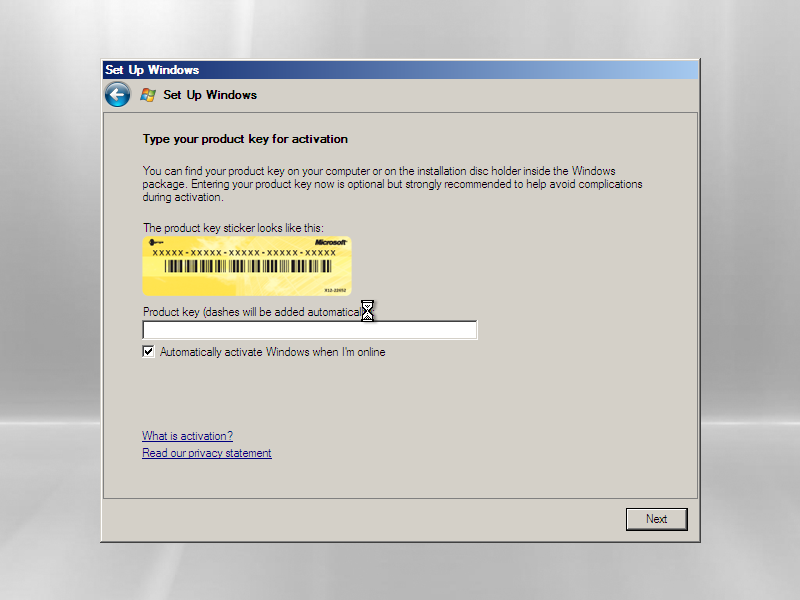

# Isolated guest environment and actual attempt

Status: **guest boot attempted; CyberView detection not attempted.** The official
Microsoft Server2008 Enterprise x86 evaluation VHD advanced through regional OOBE
to the product-key setup page in QEMU.
CyberView was not installed/launched, and no PF1800 USB device was presented.
The user subsequently stopped Computer Use with the physical Escape key; UI
automation ceased and the research QEMU process was stopped. No authentication,
password, activation or security setting was bypassed.



This is a lossless PNG conversion of an actual QMP guest screendump, not a
mockup. The raw PPM remains in ignored `.artifacts/guest-lab/`. The visible screen
is Windows setup, not original CyberView.

## Media and terms examined

The bounded inventory initially found VirtualBox installed with no registered
machines. No user-provided licensed XP/Vista/7 image was available. Research then
located the [official Microsoft Server2008 x86 evaluation VHD](https://www.microsoft.com/en-us/download/details.aspx?id=14527).
The three official archive parts, retrieval URLs, hashes, README/EULA hashes and
extraction process are in [acquisition/inventory.md](acquisition/inventory.md).

The supplied XPS EULA was read before boot: internal demonstration/evaluation,
60 days from first installation, no activation, no redistribution/live production;
it permits a virtualizer capable of VHD. The README describes Hyper-V setup and
explicitly instructs leaving the product key blank and disabling automatic
activation. No activation, rearm, date rollback or expired-evaluation bypass was
attempted. The exact guest's expiry state was not reached/verified. Server2008 is
an experimental Vista-era x86 testing environment; the scanner vendor's stated
support is XP/Vista/7, not Server2008.

Preserved VHD SHA256:
`BC57268875AB4589F2F11B766FA214BBE11B5349B427EC518E2A6316E2DED19D`.
`qemu-img info` actually recognized `vpc`, dynamic VHD, virtual size
136,365,211,648 bytes, file size7,653,676,032 bytes, cluster524,288, clean.
The base hash was checked before preparation, before resumed start and after
stopping; it remained unchanged. No host Hyper-V/WSL/USB driver was installed.

## Actual QEMU laboratory configuration

Portable QEMU11.1.0 (`v11.1.0-12130-ge470268ff4`) was obtained through
[QEMU's Windows download reference](https://www.qemu.org/download/#windows) to
Stefan Weil's `qemu-w64-setup-20260811.exe`. The archive was extracted with7-Zip;
its installer was not executed. Download size206,615,928 bytes, matching published
SHA512:
`5BCF9EED634E8575A37B74F445AF41A2FE4106DA512D0C30C368301D4C105037FDFAB40A5287367A28A957624CDDEBBC8C07E16C88AB6634F554CDF3D16BF543`.

The actual evaluation run used:

* QEMU TCG, pc machine,2 virtual CPUs,1024MiB RAM, IDE system disk.
* Writable qcow2 overlay; explicit read-only `base-file` and `base-vhd` nodes.
* No NIC, shared host directories, clipboard integration, VNC listener or host
  USB passthrough. QMP bound only to127.0.0.1 on an ephemeral port.
* Accurate current host-derived RTC (`base=utc,clock=host`), without date changes.
* Read-only ISO containing only the preserved official CyberView installer and
  its hash. Attaching this CD did not execute the installer.
* Standard virtual UHCI controller. A second start added QEMU's generic USB tablet
  to address relative-pointer behavior. This was not a scanner emulator.
* Active10-second checks for≥8GiB host reserve and≤2GiB overlay, plus a five-minute
  first-pass watchdog. Observed overlay remained about139MB; recorded free space
  remained above27GB during the resumed pass. Persistent runtime records and
  absolute paths remain ignored.

The earlier diskless/stopped QMP smoke test actually passed and reported
`status=prelaunch`, `running=false`; [its log](../usb/evidence/qemu-smoke-2026-10-27.json)
is infrastructure evidence. An initial stdio-QMP attempt timed out; a bounded
loopback-QMP version corrected it. No guest OS or CyberView was involved in that
smoke test.

## Actual UI outcome and stop boundary

On 2026-10-28 UTC the resumed guest reached the Windows Server2008 country/time/
keyboard regional setup. Inputs through Computer Use initially appeared delayed
or misdirected; the relative virtual pointer opened a locale dropdown. The later
saved QMP frame shows that setup had advanced to **Type your product key for
activation**. Its key field is blank and the default **Automatically activate
Windows when I'm online** checkbox is checked. No product key was entered, no
activation was submitted, no network was present and no expiry warning is visible.
The first pass stopped and the same overlay restarted with an absolute USB tablet.
Before further observation/input, Computer Use returned:

> Computer Use was stopped by the user with the physical Escape key.

No further Computer Use calls were made. QEMU was stopped through its own QMP
socket and the base hash was rechecked. Consequently there is **no original
CyberView startup, no no-device baseline, no original-driver communication log,
no virtual-device recognition result, and no sample image**. The result is an
interrupted guest-preparation attempt, not a failed vendor-detection experiment.

If a later authorized continuation reaches login/password/security prompts, the
Computer Use skill's explicit boundaries apply: do not automate authentication
dialogs, do not act on security permission requests, and hand off final password
changes. Ordinary regional setup and authentication are separate stages. This
pass never reached an authentication dialog. The installed skill source read for
this pass was `computer-use/26.1023.50603/skills/computer-use/SKILL.md`, with its
bundled `docs/guidance.md` and `docs/confirmations.md`.

## Reproduction and remaining work

The source [analysis/guest_lab.py](analysis/guest_lab.py) resolves paths from the
repository, verifies the base/vendor/ISO hashes, creates a dedicated overlay and
CD, launches the isolated machine and monitors bounds. Tools, ISO, VHD, overlays
and process configuration are ignored. For an independently authorized new run,
first obtain the exact official artifacts/terms and portable tools, then:

```powershell
python -m venv research/.tools/analysis-venv
research/.tools/analysis-venv/Scripts/python.exe -m pip install -r research/cyberview/analysis/requirements.txt
research/.tools/analysis-venv/Scripts/python.exe research/cyberview/analysis/guest_lab.py prepare
python research/cyberview/analysis/guest_lab.py start
python research/cyberview/analysis/guest_lab.py status
python research/cyberview/analysis/guest_lab.py stop
python research/cyberview/analysis/guest_lab.py verify-base
```

`prepare` refuses to overwrite an existing experiment. `start` resumes that
overlay without bypassing setup/authentication. Do not restart UI control after
the user's Escape stop without fresh user steering. A Windows11 application-only
compatibility-mode test was not attempted; see the separate
[Windows11 note](windows11-compatibility.md).

Original CyberView still needs a completed permissible guest setup and actual
no-device launch. The likely `SCAN08.dll` dependency gap must be resolved or
observed at runtime. Genuine PF1800 descriptors and initialization traces remain
missing. These are separate from the now-available evaluation media.

USB/IP and QEMU usbredir are distinct protocols. A Python USB/IP socket cannot be
connected directly to `-device usb-redir`; see
[Linux USB/IP](https://docs.kernel.org/usb/usbip_protocol.html),
[QEMU USB](https://www.qemu.org/docs/master/system/devices/usb.html), and
[usbredir](https://www.spice-space.org/usbredir.html).
After descriptor/command evidence exists, either implement a QEMU USB model or
validate a separate usbredir adapter/isolated Linux relay. Neither bridge nor a
guest-visible PF1800 profile exists yet. The tested Python laboratory intentionally
returns no USB/IP devices and rejects IMPORT rather than fabricating a scanner.
